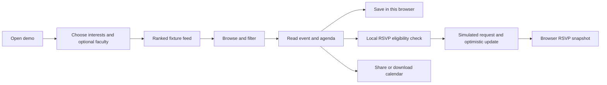
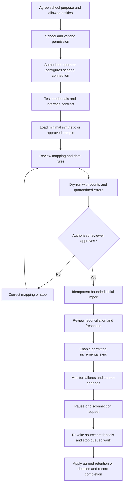
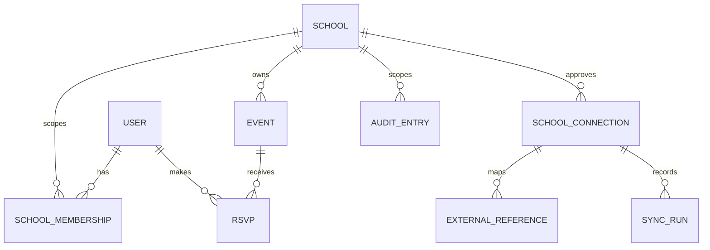
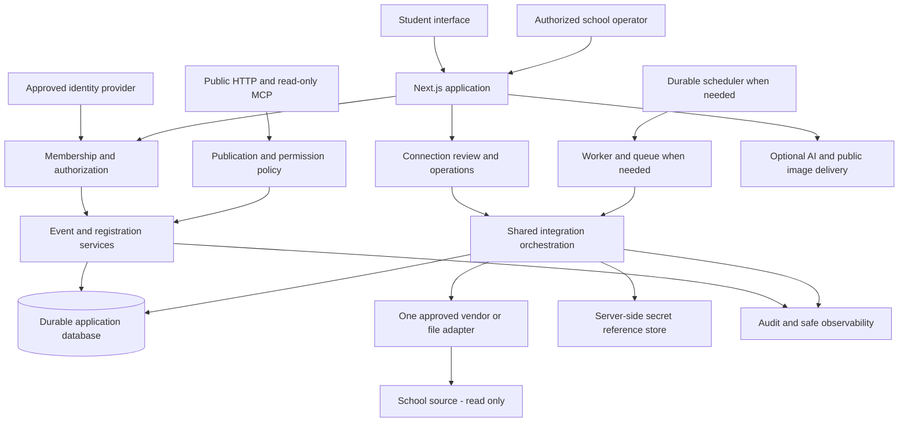

# Campus Events: Project Information

**Product assessment and proposed institutional integration plan — 17 October 2026.** This document distinguishes the working campus events demonstration from the work required to serve real schools. Technical setup, current routes, versions and source structure are in [README.md](README.md).

No school partnership, vendor connection, production service level, legal certification or completed user research is evidenced in the repository. Requirements, targets, ownership roles and architectures described as proposed are specifications for future work, not completed capabilities.

## Contents

- [Executive summary](#executive-summary)
- [Evidence and status](#evidence-and-status)
- [Problem and value hypotheses](#problem-and-value-hypotheses)
- [Stakeholders and responsibilities](#stakeholders-and-responsibilities)
- [Current and proposed workflows](#current-and-proposed-workflows)
- [Priorities](#priorities)
- [Gap analysis](#gap-analysis)
- [Functional requirements](#functional-requirements)
- [Nonfunctional requirements](#nonfunctional-requirements)
- [School integration specification](#school-integration-specification)
- [Canonical data and identifiers](#canonical-data-and-identifiers)
- [Synchronization and failure handling](#synchronization-and-failure-handling)
- [Proposed architecture](#proposed-architecture)
- [Security privacy and governance](#security-privacy-and-governance)
- [Discovery and school research](#discovery-and-school-research)
- [Bounded MVP](#bounded-mvp)
- [Phased delivery plan](#phased-delivery-plan)
- [Risk register](#risk-register)
- [Success measures](#success-measures)
- [Decision register](#decision-register)
- [Immediate next actions](#immediate-next-actions)
- [Review and maintenance](#review-and-maintenance)

## Executive summary

Campus Events currently helps a student explore ten fictional campus events through an interest-based feed, browse filters, details, agenda, maps, local saves, simulated RSVPs and calendar/share actions. Responsive layouts, schema validation, deterministic recommendations, optional AI helpers and read-only MCP are implemented. The application is configured for a single fictional Example University.

The current stage is a **functional demonstration with prototype data and registration**. It is suitable for validating interaction ideas, demonstrating the product and testing a deployment workflow. It is not an authoritative school registration system. Browser-local records have no verified owner, cannot enforce shared capacity and do not synchronize across devices. Catalogue dates shift with the demo clock.

The strategic direction is an institution-connected event service: verified school membership, stable approved event records, trustworthy registrations and one supported connection to an existing institutional system. This should build on the modular Next.js application rather than replace it with a speculative platform architecture.

Recommended next development milestone: **an authoritative authenticated event-and-RSVP foundation, informed by discovery with one school**. Discovery must establish what data can actually be obtained, for what purpose and under whose authority. A first connector should be read-only, bounded and reversible. It may import approved events or minimally verify membership if the institution supports that path; the product owner must not assume a particular vendor API exists.

Grades, fees, full timetables, guardians, payroll, medical records, biometrics and a replacement SIS are outside the first proposed MVP. Broadening into those domains would require separate research, authorization, risk assessment, ownership and delivery decisions.

## Evidence and status

The assessment inspected package/lockfile, App Router screens, hooks/stores, schemas, event repository/service, HTTP/AI/MCP handlers, scripts, test configurations, GitHub workflow and existing deployment/decision documents. Local environment secret values were not used or copied.

Fresh verification on this assessment: `npm run check` passed lint, strict TypeScript and **69 tests in 15 files**. Earlier build/E2E/MCP/audit results are recorded in [docs/DECISIONS.md](docs/DECISIONS.md); they are historical and were not repeated here. All ten root-level event cover URLs were subsequently verified to return HTTP 200 with image/png. Account access, upload operations, venue assets, actual Gemini generation, current deployment and school interfaces remain unverified.

Status vocabulary is shared with [README current state](README.md#current-state): **Implemented**, **Partially implemented**, **Prototype**, **Planned**, **Needs verification**, **Blocked**. A Planned capability has not been built. Blocked applies to a specific activity with a missing prerequisite, not the entire project.

| Capability             | Current status and evidence                             | Desired institutional state                                   | Gap                                                     |
| ---------------------- | ------------------------------------------------------- | ------------------------------------------------------------- | ------------------------------------------------------- |
| Discovery              | Implemented screens/filters/scoring over fixtures       | Relevant, approved, current activities                        | Validate usefulness and replace source.                 |
| Catalogue              | Prototype JSON and configured venues                    | Stable event IDs/times, ownership, revisions and cancellation | No publishing/source lifecycle.                         |
| Student profile        | Implemented preference UI; local store                  | Verified identity, scoped membership and optional preferences | No account or school membership.                        |
| Saves                  | Prototype browser persistence                           | Account-backed cross-device list                              | No durable owner/server storage.                        |
| RSVP                   | Prototype simulated mutation                            | Authoritative capacity, duplicate prevention, cancellation    | No shared transaction or registration API.              |
| AI explanations/search | Implemented fallback; live Gemini Needs verification    | Optional, safe assistance with measured usefulness/cost       | Account/model/privacy and evaluation unresolved.        |
| Images                 | Partially implemented delivery; local generated pack    | Approved assets with correct CDN IDs/provenance               | Upload completeness and venue assets unverified.        |
| Public MCP             | Implemented read-only fixtures                          | Explicitly public catalogue or authenticated scoped data      | No school publication/access policy.                    |
| Deployment             | Workflow Implemented; live operation Needs verification | Owned environments, runbook and monitored release             | Remote wiring/domain and operational ownership unknown. |
| School integration     | Planned; no adapter exists                              | One approved and testable source connection                   | Discovery, rights, schema and test access missing.      |
| School pilot           | Blocked                                                 | One named school's accepted bounded trial                     | Sponsor/permission/interface prerequisites absent.      |

## Problem and value hypotheses

The campus-events application is a concrete starting point. The following broader problems must be tested with institutions, not presented as facts about all schools.

| Hypothesis                                         | Potential consequence                          | Evidence needed                                                       | Possible value if validated                     |
| -------------------------------------------------- | ---------------------------------------------- | --------------------------------------------------------------------- | ----------------------------------------------- |
| Announcements are spread across channels           | Students miss activities or find stale details | Examples of channels, update trails and student discovery tasks       | One accurate discovery view.                    |
| Organizers re-enter the same event information     | Duplicate effort/inconsistent times            | Observe a real publishing process and measure re-entry                | Approved import and clear source ownership.     |
| Interest-based discovery is useful                 | Generic lists are harder to navigate           | Compare task success and relevance feedback, including non-AI version | Better discovery with controllable preferences. |
| School sign-in/membership can support trusted RSVP | Unverified registrants or repeated sign-ups    | Current identity policy and real registration exceptions              | Account-backed, authorized registration.        |
| Integration can reduce support work                | Staff resolve missing/incorrect data manually  | Baseline issue log and process time                                   | Traceable freshness and exception handling.     |
| Students have mobile/access constraints            | An otherwise functional service excludes users | Device/network/accessibility research                                 | Responsive, lightweight and accessible flows.   |

The project should retain deterministic search/recommendations if live AI adds insufficient value or unacceptable disclosure/cost. Useful integration should reduce a validated task burden, not merely demonstrate data movement.

## Stakeholders and responsibilities

These are proposed responsibility roles, not assigned named team members or existing customers.

| Stakeholder                        | Current relationship                                 | Future responsibility/need                                                                            |
| ---------------------------------- | ---------------------------------------------------- | ----------------------------------------------------------------------------------------------------- |
| Students                           | Intended demo users with local preferences           | Accessible discovery, trustworthy event details and control over their own registrations/preferences. |
| Event organizers                   | Organizer strings in fixtures, no organizer accounts | Publish/correct/cancel within granted scope, manage capacity and review permitted registration data.  |
| School sponsor/administrator       | No configured institutional administrator            | Approve purpose/scope, publication and pilot acceptance; nominate data owners.                        |
| School IT/integration contact      | No confirmed contact                                 | Identify vendor/version, approved transport, auth, sandbox, limits and operational changes.           |
| School privacy/legal lead          | Not assigned                                         | Establish applicable obligations, roles, notices, agreements and assessment/sign-off.                 |
| Integration operator               | No console/role                                      | Review mapping, quarantine/errors, retry, freshness and disconnect safely.                            |
| Platform owner                     | Project owner, responsibilities to confirm           | Product scope, budget, license, platform vendors and institutional agreements.                        |
| Developer/technical lead           | Source and tests exist                               | Architecture, permission boundaries, quality, migrations and connector contracts.                     |
| Support/operations lead            | No established rota                                  | Release, incident response, access, backups, recovery and vendor escalation.                          |
| Teachers/academic staff, guardians | No current user workflows                            | Research separately only if future scope requires them; not assumed MVP users.                        |

An institution must identify who can authorize access and who owns each field. A developer's ability to obtain a file or credential is not approval to use it.

## Current and proposed workflows

### Current student journey



This journey has no school verification or official registration. Fixtures include a full workshop, nearly full CV clinic, past fun run and overlapping Open Mic/Chess events for state testing. Conflict checks protect only the local snapshots, not an official timetable.

### Proposed institutional student journey

**Planned:** open school context → authenticate through approved identity method → establish authorized school membership → read approved/current events → register through transactional service → receive authoritative confirmation → cancel or review from another device. If membership cannot be established, explain the limitation without silently creating enrolment. Cancellation, stale/offline responses and event rescheduling need explicit UI states.

### Proposed connection and import lifecycle



All connection screens, approval records, dry-run reports, scheduling and disconnect behavior are **Planned**. Pausing should preserve a safe checkpoint; disconnecting must prevent running/queued jobs from continuing unauthorized access. Imported records need visible stale/disconnected state and policy-driven retention rather than disappearing unpredictably.

## Priorities

| Priority | Definition                                                                        | Release rule                                                                            |
| -------- | --------------------------------------------------------------------------------- | --------------------------------------------------------------------------------------- |
| P0       | Critical safety, authority or correctness requirement for a defined release scope | Do not enable that scope until accepted; e.g. no private school data without isolation. |
| P1       | Necessary for the next agreed milestone                                           | Schedule with explicit owner/dependencies.                                              |
| P2       | Important reliability, usability or maintainability improvement                   | Sequence using measured risk and pilot evidence.                                        |
| P3       | Optional or later expansion                                                       | Defer until value, permissions and ongoing ownership are established.                   |

Severity describes impact if a gap is encountered; priority also considers timing/dependencies. An integration blocker does not prevent local demo work. No dates, staffing commitments or percentage complete are invented.

## Gap analysis

**E = repository evidence; H = research hypothesis.** Acceptance criteria below are proposed future checks, not completed tests.

| ID/category           | Gap and basis                                                    | Impact/severity                                                  | Solution                                                                | Dependencies                            | Priority                                    | Acceptance criterion                                                                                             |
| --------------------- | ---------------------------------------------------------------- | ---------------------------------------------------------------- | ----------------------------------------------------------------------- | --------------------------------------- | ------------------------------------------- | ---------------------------------------------------------------------------------------------------------------- |
| G01 Functional        | E: RSVP uses local store/simulated request                       | Untrusted capacity/ownership; critical for official registration | Account-backed registration service with atomic capacity/cancel         | Identity, database, event owner rules   | P0 before official RSVP                     | Concurrent requests never overbook; duplicate retries create one registration; unauthorized cancellation denied. |
| G02 Functional        | E: No event publishing/admin workflow                            | Stale/unapproved details; high                                   | Define source authority and minimal organizer/review lifecycle          | Discovery, permissions                  | P1                                          | Approved event can be created/imported, revised/cancelled with attributed history.                               |
| G03 Technical         | E: Hourly fixtures and snapshots diverge                         | Wrong real schedule; high                                        | Stable times/revisions, timezone semantics and reschedule policy        | Durable catalogue                       | P1                                          | Stored registration references stable event revision; reschedule behavior passes boundary tests.                 |
| G04 Interoperability  | E: No adapter; vendor/schema unknown                             | Cannot promise connectivity; high                                | Confirm one supported interface and adapter contract                    | School/vendor permission and sandbox    | P1                                          | Signed-off capability matrix plus contract fixtures and successful dry-run.                                      |
| G05 Security          | E: No identity, membership or per-object authorization           | Private/cross-school exposure; critical                          | Verified account membership and server-enforced scope                   | Identity design, tenancy model          | P0 before private data                      | Unauthenticated/cross-school/object substitution tests deny access across routes/tools/jobs.                     |
| G06 Security          | E: Per-instance quota; incomplete payload bounds                 | Abuse/cost/memory pressure; high if publicly used at scale       | Bound bodies/fields, shared rate/cost controls, proxy trust rules       | Deployment topology, budget             | P1 before broad AI exposure                 | Oversize/abuse cases bounded; coordinated quota verified; no secrets logged.                                     |
| G07 Data quality      | E: No external ID mapping, sync history or reconciliation        | Duplicates/missing/stale data; high                              | Scoped reference registry, quarantine, checkpoints and reconciliation   | Canonical model, source semantics       | P1                                          | Replay produces no duplicates; invalid rows isolated; count differences explained.                               |
| G08 Operational       | E: No backup/restore, incident rota or sync console              | Prolonged failure/data loss; high                                | Runbooks, ownership, audit, restore and retry tooling                   | Durable architecture/support owner      | P1 before pilot                             | Restore and credential-revocation exercises pass with recorded evidence.                                         |
| G09 UX                | E: Demo labels do not establish school-data provenance/freshness | False trust; high                                                | Explicit demo/official distinctions and source/status indicators        | Source policy, sync metadata            | P1                                          | Testers identify whether event/RSVP is official, current, stale or failed.                                       |
| G10 UX/accessibility  | E: Automated viewport/axe checks, no institutional manual study  | Unseen access barriers; medium/high                              | Keyboard/screen-reader/low-bandwidth testing and moderated tasks        | Representative participants and devices | P2; blockers become P0 for affected release | Agreed critical tasks work with supported access methods; severe issues resolved.                                |
| G11 Adoption          | H: Staff may resist duplicate work/new workflow                  | Low use and support burden; high                                 | Observe workflow, co-design bounded pilot and training                  | Sponsor, staff time                     | P1                                          | Pilot participants accept workflow and support responsibilities before rollout.                                  |
| G12 Governance        | E: No school agreement, confirmed jurisdiction or legal review   | Unauthorized processing; critical before real data               | Purpose/scope, roles, vendor agreements, retention and qualified review | Institution and privacy lead            | P0 before private data                      | Authorized owner signs data-flow/purpose/access/retention decisions; required reviews complete.                  |
| G13 Technical         | E: Explanation key lacks event revision; local date boundaries   | Stale text/timezone errors; medium                               | Revision-aware invalidation and explicit timezone                       | Event lifecycle                         | P2                                          | Event edit invalidates cached explanation; school-day edge cases pass.                                           |
| G14 Operational/media | E: Local generated pack; live assets/domain unverified           | Broken visuals/URLs; medium                                      | Verify 16 IDs or approved alternatives, provenance and domain           | Cloudinary/Vercel access                | P1 for demo launch                          | Covers/venues and canonical MCP/share links pass recorded live checks.                                           |
| G15 Ownership         | E: No root license or assigned long-term support                 | Distribution/maintenance uncertainty; medium                     | Decide license, asset rights and support model                          | Owner/institution decisions             | P1                                          | Ownership/license/support decisions recorded before external institutional distribution.                         |

## Functional requirements

These IDs are a proposed tracking baseline, not an existing issue tracker. Current statuses use the shared vocabulary. “Acceptance” describes the verification needed for the intended scope.

| ID   | Requirement                                     | Current status                                        | Priority                    | Acceptance                                                                                                      |
| ---- | ----------------------------------------------- | ----------------------------------------------------- | --------------------------- | --------------------------------------------------------------------------------------------------------------- |
| FR01 | Select/edit supported interests and faculty     | Implemented, browser-local                            | P1 maintain                 | UI completion requires three interests; validated recovery and editing remain functional.                       |
| FR02 | Browse/filter/detail approved campus events     | Implemented over Prototype catalogue                  | P1                          | Preserve filters, map/agenda and empty/error behavior when real source replaces fixtures.                       |
| FR03 | Explain personalized recommendations            | Implemented deterministic; live AI Needs verification | P2                          | Relevant reasons are inspectable; app remains usable with AI disabled/unavailable.                              |
| FR04 | Save events                                     | Prototype                                             | P1 for account MVP          | Account sees same saves on two devices; another account cannot access them.                                     |
| FR05 | Official RSVP/cancel                            | Prototype simulation                                  | P0 before official use      | One active registration per user/event; capacity atomic; cancellation retry safe; conflict policy documented.   |
| FR06 | Verified school identity/membership             | Planned                                               | P0 before private data      | Approved identity linkage; revoked membership loses access according to agreed policy.                          |
| FR07 | Scoped organizer/admin publication              | Planned                                               | P1                          | Approved role may publish/change/cancel only within its scope; actions audited.                                 |
| FR08 | Public versus restricted event visibility       | Planned                                               | P0 before restricted data   | Visibility enforced in UI, HTTP, MCP and direct ID access; no public cache leak.                                |
| FR09 | Configure one school connection                 | Planned                                               | P1                          | Authorized operator records transport, scope, credential reference, mapping version and approval.               |
| FR10 | Preview/approve/import minimal data             | Planned                                               | P1                          | Dry-run reports accepted/rejected counts; no production writes before approval; idempotent import.              |
| FR11 | Incremental sync and reconciliation             | Planned                                               | P1 for connector pilot      | Checkpoint safely resumes; every mismatch accounted for; freshness visible.                                     |
| FR12 | Error review, retry, pause/disconnect           | Planned                                               | P1                          | Operator can resolve quarantined records, retry bounded work and revoke access without losing traceability.     |
| FR13 | Registration history and permitted export       | Planned                                               | P2 unless pilot requires    | Authorized export includes only approved fields; access and expiry rules tested.                                |
| FR14 | Audit access/configuration/import changes       | Planned                                               | P1                          | Actor, school, action, result, timestamp and correlation are recorded without payload secrets.                  |
| FR15 | Event change/cancellation communication         | Planned                                               | P1 for real event lifecycle | Owner-approved channel or in-app status communicates changes; delivery limits visible; no silent fixture drift. |
| FR16 | Keep MCP read-only or explicitly permissioned   | Implemented on public fixtures; school policy Planned | P0 before school exposure   | Only approved public fields anonymous; any restricted tool authenticates/authorizes and avoids private logs.    |
| FR17 | Retention/deletion/disconnection workflow       | Planned                                               | P0 before private data      | Approved policy applied across database, logs, backups and source linkage; evidence retained appropriately.     |
| FR18 | Grades, fee balances, guardian/academic modules | Planned, outside MVP                                  | P3                          | Separate validated purpose, permission, model and delivery approval before implementation.                      |

## Nonfunctional requirements

All numerical thresholds here are **proposed acceptance targets for discussion**, not measured performance or contractual SLAs. School scale/network needs must be measured before finalizing a budget or capacity promise.

| ID   | Requirement             | Proposed measurable acceptance                                                                                                                             | Verification/owner role                                                                  |
| ---- | ----------------------- | ---------------------------------------------------------------------------------------------------------------------------------------------------------- | ---------------------------------------------------------------------------------------- |
| NF01 | Authorization/isolation | Every private endpoint/tool/job has allow/deny cases; zero cross-school disclosures in the agreed suite                                                    | Technical/security lead, route and worker tests.                                         |
| NF02 | Transaction correctness | Concurrent requests up to agreed pilot load never exceed capacity; retries preserve one logical operation                                                  | Technical lead, database concurrency/idempotency suite.                                  |
| NF03 | Interactive performance | Provisional p95 catalogue read under 1 second at 50 concurrent synthetic users on the agreed pilot infrastructure, excluding external AI                   | Technical lead records dataset/network/cache assumptions and revises target with school. |
| NF04 | AI independence         | Core search/discovery/RSVP remains usable with AI unavailable; bounded AI timeout retains current four-second design unless revised                        | Failure-injection tests and usability review.                                            |
| NF05 | Connector reliability   | Replaying any approved batch creates zero duplicate logical records; checkpoint resumes after simulated crash without omissions                            | Integration lead, contract/failure tests.                                                |
| NF06 | Freshness               | Agree a source-specific maximum lag; display last successful sync and flag all records beyond it                                                           | School data owner/operator; timestamp and outage tests. No lag target committed yet.     |
| NF07 | Recovery                | Provisional RPO 24 hours and RTO 4 hours for pilot, subject to cost/data-risk approval; prove with a restore exercise before launch                        | Operations/data owner. Not achieved or contracted.                                       |
| NF08 | Availability            | Select monitoring period, business hours, exclusions and funded support before setting an uptime objective                                                 | Owner/operations. No current availability claim.                                         |
| NF09 | Accessibility           | Proposed WCAG 2.2 AA target for MVP critical flows, automated checks plus keyboard/screen-reader review; zero unresolved critical blockers                 | UX/accessibility reviewer; complete conformance not asserted.                            |
| NF10 | Mobile/network use      | Test agreed tasks at existing seven viewports and an agreed constrained-network profile; record transfer sizes and completion times before setting budgets | UX/technical lead with school devices.                                                   |
| NF11 | Observability           | Every sync run and failed authoritative mutation has correlation ID, safe error category and operator-visible status                                       | Operations lead; trace a synthetic failure end-to-end.                                   |
| NF12 | Privacy/security        | No secrets in repo/client/log output; approved data inventory/retention; revoked credentials stop new source access                                        | Privacy/security lead; scans and revocation exercise.                                    |
| NF13 | Maintainability         | Preserve strict TS/lint/tests; adapter contracts versioned; source schema changes fail safely into quarantine                                              | Technical/integration lead; CI and compatibility fixtures.                               |
| NF14 | Cost control            | Set per-environment AI/cloud/job budgets, alert thresholds and emergency disable switches before public/pilot load                                         | Owner/operations; budget alert and disable test.                                         |

## School integration specification

**Everything in this section is Planned.** No school/vendor endpoint, connector capability or data-sharing permission is implied. The initial integration is one school, one confirmed transport and only approved entities.

### Step 1: Discover the real source and permission boundary

Record school legal identity, sponsor, data owner, technical contact, vendor/product/version, hosting arrangement and support contact. Confirm whether an event module even exists. Collect authoritative API/export documentation, change policy and licensing restrictions. Identify available authentication, roles/scopes, rate limits, pagination, timestamps/timezones, stable IDs, deletions, sandbox and test users.

Define the task integration solves and the minimum fields required. Determine who may authorize school access and whether vendor approval/payment is needed. Obtain written scope and permitted environments. Do not treat a student's portal access as permission to scrape an entire system. A lack of API or sandbox is a discovery result, not justification to bypass controls.

Deliverable: approved interface capability matrix, data inventory, source authority statement, sample synthetic schemas and unresolved questions. Exit: one path is feasible and authorized, or explicitly declare no feasible connector and use a manual demo while discovery continues.

### Step 2: Choose one transport

| Method                             | Useful when                                            | Preconditions                                                                    | Benefits                                     | Risks/constraints                                                      | Initial recommendation                                                       |
| ---------------------------------- | ------------------------------------------------------ | -------------------------------------------------------------------------------- | -------------------------------------------- | ---------------------------------------------------------------------- | ---------------------------------------------------------------------------- |
| Documented API                     | Vendor supports necessary read resources               | Approved credentials/scopes, docs, limits, version and test environment          | Structured incremental access and validation | Quotas, pagination bugs, schema/auth changes, licensing                | Preferred if actually supported; not assumed.                                |
| Signed webhook                     | Source can emit supported event changes                | Verified signature/replay handling and event IDs; reconciliation source          | Lower latency                                | Missing/out-of-order/duplicate deliveries; not a full initial snapshot | Supplement a verified baseline read/export, not sole truth without recovery. |
| Approved CSV/Excel/JSON export     | School can legally produce a supported export          | Template/version, secure transfer, responsible uploader, export semantics        | Practical pilot with clear review/dry-run    | Stale/partial files, encoding/timezone/ID errors and manual burden     | Viable first connector if API unavailable.                                   |
| Authorized read-only database view | Institution/vendor explicitly permits supported access | Written approval, narrow views, least-privilege network/account, schema contract | Access where no supported API exists         | Tight coupling, security/support/upgrade risk                          | Exception, never default; no direct writes.                                  |
| Manual entry                       | Small event scope or no approved interface             | Named event owner, validation and review                                         | Keeps service usable without integration     | Re-entry and stale records                                             | Transparent fallback, not called automated integration.                      |

Avoid unsupported scraping, shared administrator credentials and write access to vendor production tables. Choose according to actual school permission, reliability, operator effort and maintenance cost—not a presumed universal vendor capability.

### Step 3: Define scope, canonical mapping and authority

Map only fields needed for the event MVP. Record source field/type, canonical field/type, transformation, timezone, null handling, validation, owner and sensitive classification. Identify source-owned versus locally editable fields. Define how cancelled/restricted events and inactive membership should appear.

An approved import must not silently overwrite organizer-owned text or combine two students with similar names. Treat ambiguous/missing identities as exceptions for authorized review. The canonical model and conflict policy below must be agreed before enabling imports.

### Step 4: Implement a vendor adapter behind shared services

Common integration responsibilities: authenticate the operator, derive school context from trusted membership, enforce approved scope, run validation, assign internal IDs, upsert external references, manage checkpoints/idempotency, quarantine, audit, metrics and retention. Vendor responsibilities: auth handshake/refresh, source paths, pagination/cursors, timestamp semantics, field translation, error/rate-limit interpretation and declared supported capabilities.

A proposed contract, **not an existing interface**, is:

```typescript
interface SchoolAdapter {
  capabilities(): CapabilityDeclaration;
  validateConnection(context: ConnectionContext): Promise<ConnectionCheck>;
  readPage(request: ScopedReadRequest): Promise<CanonicalPage>;
  inspectSchema(context: ConnectionContext): Promise<SchemaFingerprint>;
  disconnect(context: ConnectionContext): Promise<void>;
}
```

The types above are design placeholders, not importable project types. `ScopedReadRequest` should contain trusted school/connection identity, approved entity, cursor/since boundary, page limit and correlation ID. `CanonicalPage` should contain validated candidates, source references/revisions, next cursor and completeness metadata, never embedded credentials. A file adapter may produce pages from an approved uploaded artifact; a webhook adapter needs a separate verified intake contract. Do not force every adapter to claim unsupported incremental/deletion features.

Keep current event read services as a useful domain seam, but extend the domain deliberately: today's `EventRepository` lacks tenancy, write transactions and sync contracts. No student-facing component should call a school vendor directly. Avoid speculative vendor-specific implementations until a real contract is supplied.

### Step 5: Implement controlled synchronization

Build a dry-run and review step before the first write. Use bounded pages/batches, stable keys, durable run history/checkpoints, transactional writes and safe retries. Define initial import, incremental update and reconciliation separately. Add visible freshness, source attribution, revision/conflict and quarantine handling. See [detailed failure rules](#synchronization-and-failure-handling).

### Step 6: Test safely before real data

Use synthetic fixtures for all mappings and negative cases first. Test sandbox credentials/scopes, paging boundaries, repeated rows, missing IDs, invalid dates/capacity, same-name people, same external ID across schools/connections, rate-limit/backoff, outages, schema changes, out-of-order events, deletions and revoked credentials. Test imports interrupted between database commit and checkpoint update.

Only use approved anonymized samples where needed; anonymization must be assessed, not assumed from removing names. Keep test and production credentials/data separate. School IT validates actual fields/counts, the privacy lead validates handling, and the operator validates error correction and disconnect. No production write-back is part of this pilot.

### Step 7: Pilot one school and evaluate before expansion

Select a willing school with a sponsor, data owner, clear event use case, confirmed interface, safe test path and available support. Agree allowed participants, duration/review points, source entities, acceptance criteria and rollback/disconnect policy before start; no calendar is committed here.

First run read-only source access and a dry-run comparison. Import the minimal approved set, review discrepancies, demonstrate retry/revocation/restore, then admit the agreed pilot group. Record task results, support incidents, source lag and operator effort. The school signs acceptance or requests scoped remediation. A second vendor/school follows evidence, not an assumption of universal compatibility.

## Canonical data and identifiers

This is a **proposed domain model**, not implemented database tables. Choose the database/ORM after access, transactions, hosting and recovery requirements are agreed. A managed relational database is a candidate because registration uniqueness and capacity need transactional guarantees; no provider is selected.

| Proposed entity   | Minimum purpose/fields                                                                       | Rules                                                                                |
| ----------------- | -------------------------------------------------------------------------------------------- | ------------------------------------------------------------------------------------ |
| School            | Internal ID, approved display identity, timezone, status                                     | Tenant boundary; names are not unique identifiers.                                   |
| User              | Internal account ID and approved identity-provider subject reference                         | Separate authentication from enrolment; minimize personal fields.                    |
| SchoolMembership  | School/user linkage, role, status, verification source/time                                  | Explicit membership and revocation; permissions server-enforced.                     |
| Event/Venue       | Internal IDs, school, stable time/location, source/provenance, revision/status               | Preserve current useful event schema; add authority/lifecycle deliberately.          |
| RSVP              | School, user, event, status, timestamps, idempotency context                                 | One active logical registration per user/event; transactional capacity.              |
| SchoolConnection  | School, adapter/vendor version, allowed entities/scopes, secret reference, status, approvals | Never store secret in public metadata; disabling stops access.                       |
| ExternalReference | School, connection, entity type, external ID, internal ID, source revision                   | Scoped unique key below; retain mapping history appropriately.                       |
| SyncRun           | Connection, mapping version, cursor/checkpoint, counts, result, timestamps, correlation      | Durable restart/reconciliation evidence without raw sensitive payload logs.          |
| AuditEntry        | Actor/service, school, action, resource reference, result/time/correlation                   | Permission-controlled, retention-defined and resistant to unauthorized modification. |

Canonical external identity key:

```text
(schoolId, connectionId, entityType, externalId)
```

Do not use a global name, email or admission number as the integration key. Source IDs may collide across schools, entity types or replaced installations. Admission numbers/emails may be changed or reused. A connection re-created after migration needs explicit linkage/migration review, not automatic merging.

Maintain independent internal IDs. Where authorized identity linking is required, use an approved school/provider mapping and review ambiguous matches. Never infer verified membership from a browser profile, faculty string or event registration. Avoid full learner-directory import if point verification meets the purpose.



This diagram omits implementation details such as indexes, audit immutability, composite uniqueness and database access policies. Those must be designed/migrated/tested; diagram relationships alone do not enforce isolation.

## Synchronization and failure handling

| Concern                  | Proposed behavior                                                                                                    | Required proof                                                                                      |
| ------------------------ | -------------------------------------------------------------------------------------------------------------------- | --------------------------------------------------------------------------------------------------- |
| Initial import           | Approved snapshot/file/page scope; dry-run counts and mapping version; bounded batches                               | School reviewer reconciles accepted/rejected records before scheduling.                             |
| Incremental reads        | Source cursor or updated-since watermark with documented overlap; store source time and ingestion time               | Records on page/time boundaries are neither lost nor duplicated.                                    |
| Checkpoints              | Persist after successful transactional batch; replay safe if process crashes between commit/checkpoint               | Crash/restart tests recover without logical duplicates.                                             |
| Idempotency              | Unique scoped external references, revision comparison and operation key for replay                                  | Same batch/webhook/file repeated produces same logical state.                                       |
| Conflict authority       | Field-level source/local ownership; source edits only overwrite source-owned fields; ambiguous changes quarantined   | Conflicting organizer/source edit follows approved policy and audit.                                |
| Ordering                 | Ignore or review obsolete source revisions; source without revisions needs documented timestamp/hash strategy        | Out-of-order events cannot silently revert newer accepted data.                                     |
| Retries                  | Retry transient network/5xx/429 with bounded exponential backoff/jitter; honor retry hints; no infinite retry        | Injected outage/quota respects limits and gives visible terminal/pending status.                    |
| Authentication failure   | Stop/pause connection; notify authorized operator; do not hammer invalid credentials                                 | Revocation prevents new reads and queued work cannot bypass disabled state.                         |
| Invalid records          | Quarantine per record with safe field/error reference; valid records may continue only under approved partial policy | Counts and partial status are visible; operator can correct/replay.                                 |
| Schema drift             | Detect fingerprint/contract mismatch; fail closed for affected mapping                                               | Unknown required field/type change stops unsafe import; compatible additions handled intentionally. |
| Deletions/inactivation   | Use documented tombstones/status; do not equate missing row in partial page/export with deletion                     | Partial file cannot mass-delete; true cancellation/revocation follows reviewed rule.                |
| Reconciliation           | Periodic approved full/summary comparison with counts and sampled references                                         | Every unexpected difference classified and resolved or explicitly accepted.                         |
| Freshness                | Last attempted/successful run, source timestamp, lag and stale indicator                                             | Outage is visible; old data is not presented as just updated.                                       |
| Disconnect               | Disable new/queued work, cancel safe in-flight activity, revoke credentials, apply retention                         | Test no further source calls; disposition and audit evidence recorded.                              |
| Privacy-safe diagnostics | Correlation IDs, counts, redacted references/errors; restricted temporary payload inspection only if approved        | Logs contain no credential/private payload leakage.                                                 |

For MVP, imported source data is read-only upstream. Any later write-back needs a separate authority, permission, idempotency, conflict and recovery design. An “attendance” state must not be inferred from an RSVP or calendar download.

## Proposed architecture

**Planned**, extending the current modular Next.js application. Maintain domain boundaries before introducing separate services. A queue/worker is justified when approved sync work cannot safely finish within request execution limits; a durable scheduler is needed only when scheduled synchronization is agreed. Do not run reliable background work as an untracked timer inside a request instance.



Separate public catalogue resources from private membership/registration. Every request/job receives trusted school context and enforces it at service and persistence boundaries. UI filtering is not isolation. Worker jobs must re-check connection enabled state and current authorization, not trust old payloads indefinitely.

Database access, migrations, schema constraints, shared quotas, backups and health monitoring are not implemented. Evaluate managed services against cost, deployment region, connection pooling, transaction requirements, recovery and data agreements. Retain deterministic AI fallback; do not include private school data in prompts by default. Connector sources should feed canonical domain records rather than leak vendor schemas to the frontend.

## Security privacy and governance

This is a **proposed review plan**, not legal advice, a completed compliance assessment or certification. School jurisdiction, learner ages, controller/processor relationships and data locations are not confirmed.

### Before private data

- Establish explicit purpose, permitted fields, users, source rights, legal basis and institution/vendor approval. Treat consent as a context-dependent decision, not a substitute for all other responsibilities.
- Define identity assurance, school membership, role/object-level permissions, administrator MFA policy and access review. Test school/resource substitution and revoked access in HTTP, MCP, jobs and exports.
- Use least-privilege read credentials, secret references, rotation/revocation and separate environments. Confirm rotation of previously exposed credentials; do not reproduce them. Completion remains unverified.
- Inventory database, browser storage, logs, backups, hosting, CDN, analytics, AI and support access. Minimize data and avoid private image uploads/public URLs without an explicit approved purpose.
- Define retention/deletion/export/correction procedures, backup expiry, incident response and notices. Record who approves exceptions and who can inspect quarantine data.
- Assess cross-border processing, subprocessors, agreements, children-specific risks and any required impact assessment before a real pilot.
- Perform threat modeling, dependency review, secret scanning, payload limits, shared abuse/cost controls and authorization tests. Automated checks do not replace institutional review.

### Conditional Kenya assessment

If the selected institution operates within the relevant Kenyan legal context, qualified review should assess the **Data Protection Act, 2019**, applicable regulations and regulator guidance. Official starting points are the [Kenya Law Act text](https://new.kenyalaw.org/akn/ke/act/2019/24/eng%402022-12-31/source) and [ODPC legislation/regulations index](https://www.odpc.go.ke/data-protection-laws-kenya/), which includes General, Registration, and Complaints Handling and Enforcement regulations.

The [ODPC education-sector guidance](https://www.odpc.go.ke/wp-content/uploads/2024/02/ODPC-Guidance-Note-for-the-Education-Sector.pdf) is relevant to educational processing. If learners are children, review [ODPC children's-data guidance](https://www.odpc.go.ke/wp-content/uploads/2025/11/ODPC-%E2%80%93-Guidance-Note-for-Processing-Childrens-Data.pdf) with the institution. Use the [official guidance index](https://www.odpc.go.ke/guidelines-2/) for applicable assessment, consent and transfer guidance. Determine obligations from actual processing and current law; no registration exemption, compliance finding or universal parental-consent rule is assumed here.

Legal review belongs to qualified school/privacy advisers. If another jurisdiction is selected, replace this conditional assessment with its applicable framework. The initial adult university imagery and fictional branding do not resolve the target school's legal context.

### Proposed release evidence

A school release needs an approved data-flow inventory, access matrix, retention schedule, vendor/source permissions, incident owner, recovery evidence, critical security/accessibility findings resolved and documented school acceptance. Track these artifacts privately where needed; never commit real student samples or secrets simply to demonstrate completion.

## Discovery and school research

### Interview and observation questions

| Topic              | Questions                                                                                          | Evidence to collect                                                  |
| ------------------ | -------------------------------------------------------------------------------------------------- | -------------------------------------------------------------------- |
| School scope       | University, college, secondary or another setting? Adult/minor learners? Which country/campuses?   | Named sponsor, jurisdiction/age context and boundaries.              |
| Existing workflow  | Where are events announced, changed, approved and cancelled? Who re-enters data?                   | Observed process, sample public notices and correction trail.        |
| Student tasks      | How do students discover, decide, register and hear about changes? What fails today?               | Moderated tasks and concrete examples, not only feature preferences. |
| Authoritative data | Who owns event times/capacity/eligibility? Is RSVP separate from attendance?                       | Field ownership and registration rules.                              |
| Identity           | Which identity provider exists? How is membership verified/revoked? Guest students?                | Approved identity linkage and exception paths.                       |
| Vendor             | Exact product/version, hosting, modules and contracted interfaces? API/export licensing?           | Official docs, support confirmation and cost.                        |
| Transport          | API, signed webhook, secure export or approved views? Pagination, limits, IDs, deletion semantics? | Capability matrix and synthetic schema.                              |
| Operations         | Who handles stale data, revoked keys, errors and vendor changes? Support hours?                    | Named escalation roles and recovery expectations.                    |
| Privacy            | Who authorizes purpose/access? What notices, retention and assessments apply?                      | Institution-approved governance artifacts.                           |
| Access/adoption    | Devices, bandwidth, languages, accessibility needs and staff training?                             | Representative constraints and task baselines.                       |
| Success            | Which tasks should improve, and what would stop the pilot?                                         | Agreed measures, guardrails and exit criteria.                       |

### Discovery checklist

- [ ] Identify sponsor, event data owner, IT/vendor contact and privacy reviewer.
- [ ] Confirm institution type, jurisdiction, learner age context and exact event use case.
- [ ] Observe current publishing/registration/correction tasks; record baseline burden and failure examples.
- [ ] Verify vendor/version, interface license, documented auth/scopes and source authority.
- [ ] Obtain permission, safe test access and synthetic/approved schemas; no production samples by default.
- [ ] Record stable identifiers, timezones, pagination, quotas, change/deletion semantics and completeness.
- [ ] Agree minimal canonical fields, visibility and ownership/conflict rules.
- [ ] Select one transport; record rejected alternatives and reason.
- [ ] Approve MVP, operational responsibilities, evaluation/stop rules and data disposition.

### Pilot selection and feedback

Select one institution with a committed sponsor and operator, a documented event problem, feasible permissioned transport and safe test access. Do not select solely for its size or a vendor claim. Prefer a small, observable scope that permits recovery and candid feedback.

Include students with different interests and access needs, organizer/staff users, school IT and support. Research participation and recordings need appropriate permission. Use synthetic demo tasks first; collect minimum feedback data. Record task success, confusing states, source accuracy, operator effort and support issues. Assign each finding an owner/severity; distinguish interface problems from source errors. Repeat critical tasks after fixes, then have the sponsor decide continue/remediate/stop.

## Bounded MVP

The proposed MVP is **school-connected campus event discovery and trusted registration**, not a replacement SIS.

### In scope

1. One school with explicit boundaries and institution-approved sign-in/membership verification.
2. Stable approved event/venue records, lifecycle status, visibility and timezone; minimal organizer/admin workflow or a clearly authoritative approved source.
3. Account-backed preferences/saves and transactional RSVP/cancellation, preserving useful existing discovery/details/calendar behavior.
4. One approved **read-only source connector**: API or supported file path, chosen after discovery, with minimal allowed entities and explicit provenance.
5. Operator mapping review/dry-run, initial import, permitted updates, reconciliation, quarantine, safe retries, freshness and disconnect.
6. Authorization, audit, retention, restore and support evidence needed for that bounded pilot.
7. Optional AI only for already approved non-sensitive inputs, with deterministic fallback and budget controls.

### Out of scope until separately validated

Multi-vendor marketplace, SIS replacement, grades/results, fee/payment processing, full academic timetables, payroll, medical/biometric data, guardian portal, native mobile apps, predictive academic profiling, automated attendance inference and source-system write-back.

### Acceptance gate

The school approves source/purpose/field scope; private access and tenant/object tests pass; authoritative RSVP survives retries/concurrent capacity requests; stable event changes behave according to policy; one connector reconciles without unexplained loss/duplicates; rejected records/revocation/recovery are demonstrated; pilot users complete agreed tasks; support/privacy/security owners accept release evidence. Core flows work without AI.

If the school's source has no events, do not invent an event API. Agree a minimal manual authoritative catalogue plus an approved membership-verification connector, or revise the connection goal openly. If no permissible source path exists, keep the fixture demo separate and do not label it integrated.

## Phased delivery plan

Phases express dependency gates, not dates or completion percentages. Discovery can overlap safe demo stabilization; private-data development/testing must still respect the gates. Each phase needs an actual owner when scheduled.

### Phase 0: Assessment

- **Objective:** establish an accurate baseline and bounded product direction.
- **Tasks:** inspect repo, classify features, document setup/API/data limits, record evidence and unresolved decisions, propose MVP.
- **Dependencies:** source and owner intent; no school access required.
- **Deliverables:** README, this assessment, gap/requirements/decision registers.
- **Risks:** mistaking simulated behavior for official capability or old test evidence for current deployment health.
- **Acceptance/exit:** owner reviews scope/status and assigns next decisions; documentation links/checks pass. Documentation delivery does not mean stakeholder acceptance has occurred.

### Phase 1: Stabilization

- **Objective:** make the demonstration reproducible, deployable and honest about its limits.
- **Tasks:** confirm credential rotation; verify image rights/16 IDs or alternatives; verify model choice only if AI enabled; run check/build/relevant E2E/MCP; confirm GitHub/Vercel/domain/canonical links; label simulated registration and document support steps.
- **Dependencies:** service/account access, owner deployment/media decisions; no school private data.
- **Deliverables:** verification record, approved media mapping, known-good demo deployment and basic runbook.
- **Risks:** seeder overwrites photos, secrets published, fallback mistaken for live AI, wrong canonical URL.
- **Acceptance/exit:** smoke checks pass on intended origin, secret exclusions confirmed and demo limits understood. No institutional production approval implied.

### Phase 2: Discovery

- **Objective:** prove one school connection is authorized, useful and feasible.
- **Tasks:** interviews/observation, vendor/version/interface assessment, licensing/auth/scopes, synthetic samples, entity/field minimization, identity and governance decisions, transport selection and pilot plan.
- **Dependencies:** sponsor, data owner, IT/vendor cooperation and privacy review.
- **Deliverables:** permissioned capability matrix, canonical mapping draft, authoritative-source policy, MVP acceptance and responsibilities.
- **Risks:** no supported interface, school/vendor rights differ, scope grows into sensitive academic domains.
- **Acceptance/exit:** one path and minimal data purpose approved with safe test access; otherwise report a specific Blocked connector milestone and continue only permissible demo work.

### Phase 3: Foundations

- **Objective:** replace demo trust assumptions with authoritative event/registration services.
- **Tasks:** choose identity/database deliberately; implement school membership/permissions, stable event lifecycle/timezone, account saves/preferences, transactional RSVP/cancel, migration constraints, audit, secret management and backup/restore basis.
- **Dependencies:** approved domain/access/ownership requirements from discovery; synthetic tests initially.
- **Deliverables:** versioned durable schema/migrations, scoped services/routes, access matrix, concurrency/idempotency tests and recovery procedure.
- **Risks:** cross-school leakage, weak identity matching, overbooking, migration loss and unauthorized organizer actions.
- **Acceptance/exit:** deny/allow tests cover private surfaces; concurrent registrations do not overbook; revocation/cancel/retry/reschedule behavior documented and tested; restore demonstrated before real-data pilot.

### Phase 4: Connector pilot

- **Objective:** operate one approved read-only integration for one institution.
- **Tasks:** implement adapter contract/mapping, connection secret references, dry-run approval, bounded import, checkpoints, quarantine, retry/backoff, reconciliation/freshness and disconnect; run contract/failure tests; conduct user/operator pilot.
- **Dependencies:** foundations, permission, sandbox or approved file contract and named school reviewer.
- **Deliverables:** one adapter, fixtures/compatibility record, import/reconciliation report, pilot findings and operational evidence.
- **Risks:** schema drift, partial export interpreted as deletion, duplicates, stale data, unsupported vendor change.
- **Acceptance/exit:** source comparison has no unexplained differences; replay/crash/revocation/disconnect tests pass; authorized school reviewer accepts pilot or lists required remediation. No second connector by default.

### Phase 5: Production readiness

- **Objective:** enable a controlled institutional service with support and governance.
- **Tasks:** close critical findings, qualified privacy/security review, accessibility/manual acceptance, load/cost verification, shared limits, monitoring/alerts, backup/restore drill, incident/support training and staged release/reversal.
- **Dependencies:** accepted pilot, budget, assigned support/privacy owners and institutional agreement.
- **Deliverables:** release checklist, operational/access reviews, approved retention/notices, restore results and release sign-off.
- **Risks:** operational load exceeds staffing, unmeasured performance, data handling not approved, vendor outage.
- **Acceptance/exit:** agreed targets measured under stated conditions; P0 blockers closed; data owners/operations approve release and stopping rules. Do not claim SLA/compliance without the required separate evidence/agreement.

### Phase 6: Expansion

- **Objective:** extend only proven value with sustainable ownership.
- **Tasks:** evaluate pilot outcomes/cost, decide second school/vendor, test contract compatibility and tenant isolation, fund support; research academic/guardian/payment modules separately if proposed.
- **Dependencies:** accepted production evidence, repeatable onboarding, permission and business case for each new scope.
- **Deliverables:** expansion decision, adapter compatibility/version policy, updated requirements and funding/support plan.
- **Risks:** vendor permutations, scope creep and new sensitive-data obligations.
- **Acceptance/exit:** each new institution/path passes its own discovery, authorization, contract and rollout gates; no assumption one school's connector fits another installation.

## Risk register

Ratings are qualitative planning judgments, **not measured probabilities**. Owner entries are roles requiring assignment. H denotes a speculative external risk; E denotes a repository-evidenced gap with a prospective consequence.

| ID/basis | Risk                                                        | Likelihood                                 | Impact                           | Priority                  | Mitigation                                                                      | Proposed owner            | Trigger/review signal                                  |
| -------- | ----------------------------------------------------------- | ------------------------------------------ | -------------------------------- | ------------------------- | ------------------------------------------------------------------------------- | ------------------------- | ------------------------------------------------------ |
| R01 E    | Private records exposed through public routes/cache         | High if private data added unchanged       | Critical                         | P0                        | Identity, object/tenant checks, private cache policy, negative tests            | Technical/security lead   | Any private data proposal or permission failure.       |
| R02 E    | Official RSVP overbooking or unowned records                | High if simulation treated as official     | High                             | P0                        | Transactions, unique registrations, retry/concurrency tests                     | Technical lead            | Pilot asks for trusted capacity.                       |
| R03 H    | Vendor has no supported/licensed interface                  | Unknown                                    | High                             | P1                        | Early capability/permission proof, approved file/manual alternative             | School IT/product owner   | Missing docs/permission or quoted licensing cost.      |
| R04 H    | Source IDs/schema change                                    | Medium                                     | High                             | P1                        | Scoped keys, mapping versions, contract fingerprints and quarantine             | Integration lead          | Schema mismatch/vendor upgrade notice.                 |
| R05 E    | Secrets previously shared remain active                     | Unknown until rotation confirmed           | High                             | P0 before trusted release | Rotate/revoke, update private stores, confirm without exposing values           | Account owner             | Rotation evidence absent or exposure detected.         |
| R06 E    | Fixtures shift after local RSVP                             | High in retained demo state                | Medium/high if mistaken for real | P1                        | Explicit demo status, stable catalogue before official use                      | Product/technical lead    | Timestamp mismatch/reschedule confusion.               |
| R07 H    | Processing minors/private records without proper governance | Unknown; ages/jurisdiction unconfirmed     | Critical                         | P0 before such data       | Minimize scope and obtain qualified institutional review                        | School privacy lead       | Minor learners or new sensitive fields proposed.       |
| R08 E    | Instance-local limiter/cache fails expected global control  | Medium at scale                            | High cost/abuse                  | P1 before broad exposure  | Shared budgets/quotas, bounded payloads and instance tests                      | Operations/technical lead | Multi-instance deployment or cost increase.            |
| R09 H    | School staff reject duplicate workflow                      | Unknown                                    | High adoption                    | P1                        | Observe tasks, co-design pilot and training                                     | Sponsor/product owner     | Low task completion or repeated manual work.           |
| R10 E    | No restore/support process during data incident             | High if durable service launched unchanged | High                             | P1                        | Assigned support, backups, restore/revocation drills                            | Operations lead           | First persistent real records.                         |
| R11 H    | AI unavailable, inaccurate or expensive                     | Medium                                     | Medium                           | P2                        | Deterministic fallback, approved inputs, evaluation and disable/budget controls | Product/operations        | Model errors, poor relevance or budget alerts.         |
| R12 E    | Seeder overwrites uploaded photos                           | Medium if script misunderstood             | Medium                           | P1 demo launch            | Manual workflow, explicit overwrite warning, asset provenance                   | Media/account owner       | Running `seed:images` after photos.                    |
| R13 H    | Vendor/source outage leaves stale events                    | Medium                                     | High                             | P1                        | Freshness UI, reconciliation, stop/communication policy                         | Integration operator      | Lag exceeds agreed threshold.                          |
| R14 E/H  | Scope expands toward full SIS without resources             | Medium                                     | High                             | P1                        | Bounded MVP and new-domain approval                                             | Product owner             | Grades/fees/guardian features enter first pilot scope. |

## Success measures

No baseline, adoption percentage, uptime or improvement is invented. Collect a baseline before comparing results. Targets are agreed with the pilot school; numerical acceptance proposals in the nonfunctional register are not observed outcomes.

| Measure                    | Definition                                                                                             | Collection method                                                  | Reviewer/use                                                          |
| -------------------------- | ------------------------------------------------------------------------------------------------------ | ------------------------------------------------------------------ | --------------------------------------------------------------------- |
| Discovery task success     | Completed agreed event-finding tasks divided by attempted tasks                                        | Moderated tasks on representative devices; minimum research data   | Product/UX and school sponsor compare baseline/pilot.                 |
| Event accuracy             | Approved sampled event fields matching authoritative source divided by fields checked                  | Field-level sampled reconciliation with documented exceptions      | School event owner; stop if critical time/visibility wrong.           |
| Import completeness        | Accepted plus intentionally quarantined/ignored records accounted for against approved source snapshot | Sync counts and reference reconciliation                           | Integration operator and school IT.                                   |
| Duplicate rate             | Duplicate logical entities/registrations after replay divided by imported/registered entities          | Scoped key and replay/concurrency tests plus exception review      | Technical lead; proposed acceptance zero logical duplicates in suite. |
| Freshness                  | Source-change time to accepted local update; separately last-success age                               | Source/ingestion timestamps and scheduled reconciliation           | Data owner agrees maximum lag and review frequency.                   |
| RSVP correctness           | Confirmed registrations reconciled with durable capacity/status rules                                  | Transaction tests and approved account-level reconciliation        | Organizer/technical lead; never use local UI clicks as attendance.    |
| Operator effort            | Time and steps to review/import/resolve a defined batch                                                | Observed tasks and issue records, no unsupported time-saving claim | School operator/product owner.                                        |
| Support burden             | Categorized incidents per agreed pilot participation period                                            | Minimal ticket log, severity and resolution timestamps             | Support lead identifies recurring source/UI issues.                   |
| Accessibility/task access  | Critical tasks completed using agreed keyboard, screen-reader and device/network combinations          | Manual checklist plus existing automated checks                    | Accessibility reviewer and affected users.                            |
| AI value/cost              | Relevance/helpfulness with versus without AI, fallback rate and cost per accepted operation            | Approved test cases, provider usage and budget reporting           | Product/operations decide enable/disable.                             |
| Recovery readiness         | Successful restore, revoked-key stop and interrupted-sync recovery exercises                           | Dated test evidence with conditions/actual timings                 | Operations/security sign-off, not promised RTO without measurement.   |
| Scope/governance readiness | Required permission/access/retention/release decisions accepted                                        | Artifact checklist with responsible reviewers                      | Sponsor/privacy/owner before pilot and scope changes.                 |

## Decision register

“Owner” identifies the role expected to decide, not a person already assigned. Existing design rationales are supported by [docs/DECISIONS.md](docs/DECISIONS.md).

| ID  | Decision/status                                              | Evidence/rationale                                                    | Proposed owner               | Next action                                                        |
| --- | ------------------------------------------------------------ | --------------------------------------------------------------------- | ---------------------------- | ------------------------------------------------------------------ |
| D01 | Use current Next.js modular application — existing           | Package/source already provide screens, services and tests            | Technical lead               | Extend seams; do not introduce microservices without need.         |
| D02 | Browser-local demo state — existing Prototype                | Zustand stores and simulated RSVP; original scope supplied no backend | Product/technical lead       | Preserve honest demo, replace for authoritative MVP.               |
| D03 | Deterministic AI fallback — existing Implemented             | Optional client and validated fallback services                       | Product owner                | Retain; validate actual AI value/model before enabling.            |
| D04 | Read-only public fixture MCP — existing Implemented          | Registry annotations and handlers                                     | Technical/security lead      | Define publication policy before school records.                   |
| D05 | One school/one read-only connector first — proposed          | No current connector; bounded proof reduces unsupported assumptions   | Product owner/sponsor        | Approve scope after discovery.                                     |
| D06 | Identity provider and membership linking — unresolved        | No current identity layer; school system unknown                      | School IT/security           | Compare approved SSO/provider methods and revocation.              |
| D07 | Database/ORM/hosting region — unresolved                     | No durable model/driver exists                                        | Technical/privacy/operations | Evaluate transactions, isolation, recovery, cost and location.     |
| D08 | Authoritative event fields and organizer rights — unresolved | Fixtures cannot define institutional ownership                        | School event owner           | Sign field/conflict/cancellation policy.                           |
| D09 | Transport/vendor/version — unresolved                        | No confirmed interface/permission                                     | School IT/vendor             | Complete capability matrix.                                        |
| D10 | Jurisdiction, learner ages and data roles — unresolved       | No institution supplied                                               | School privacy lead          | Determine before personal-data scope.                              |
| D11 | Demo/media/deployment ownership — unresolved external state  | Guides exist; live accounts/assets/domain unverified                  | Project owner                | Confirm account/team/domain, approved images and rotation.         |
| D12 | License/support/budget — unresolved                          | No root license or funded support commitment                          | Project owner                | Record distribution rights, operating model and escalation.        |
| D13 | School timezone and registration conflict rules — unresolved | Current local-date/interval rules are demo choices                    | School event owner           | Decide reschedule, eligibility and calendar semantics.             |
| D14 | Shared quotas, scheduler/worker — proposed when justified    | Current limiter/cache are in-memory; no sync jobs                     | Technical/operations lead    | Select after workload/hosting requirements, adapt async contracts. |

### Questions for the project owner

1. Which specific institution and institution type is first, who sponsors it, and are learners adults, minors or mixed?
2. Is the initial business outcome event discovery/registration, and can grades/fees/guardian modules stay outside MVP?
3. Which source/vendor/version is actually used, who can authorize access, and is there a permitted sandbox/API/export?
4. Who owns event truth, capacity, eligibility, approval and cancellation? Which data may be public through HTTP/MCP?
5. What identity method and membership-linking/revocation policy does the school approve?
6. Which jurisdiction/hosting regions, retention rules and vendor agreements apply?
7. Which GitHub/Vercel/Cloudinary accounts/domain should operate the demo; have exposed credentials been rotated?
8. Who funds and owns support, privacy review, backup/recovery, licensing and future adapter maintenance?

These decisions do not prevent completion of the documentation. They gate dependent institutional implementation and release work.

## Immediate next actions

Dependency order is deliberate; safe demo work and school discovery can overlap. None is claimed completed unless supported elsewhere in this document.

| Order | Priority                  | Action                                                           | Expected outcome                          | Definition of done/dependency                                                                                                    |
| ----- | ------------------------- | ---------------------------------------------------------------- | ----------------------------------------- | -------------------------------------------------------------------------------------------------------------------------------- |
| 1     | P1                        | Review this baseline and assign product/technical/account owners | Agreed truth and scope                    | Owner accepts classifications and bounded MVP; record unresolved decisions.                                                      |
| 2     | P0 before trusted release | Confirm exposed-key rotation and secret exclusions               | Safe account configuration                | Account owner confirms revocation/replacement privately; values absent from Git/client/logs.                                     |
| 3     | P1                        | Verify media/domain/demo deployment                              | Reviewable reproducible demonstration     | Approved images/16 IDs or alternatives, correct canonical links, fresh build/E2E/MCP evidence; depends on intended accounts.     |
| 4     | P1                        | Recruit one school sponsor/data/IT/privacy contact               | Authorized discovery                      | Named responsible roles and permission to investigate, no implied data access.                                                   |
| 5     | P1                        | Complete interface/workflow discovery                            | One feasible approved connection          | Vendor/version, license/auth/schema/sandbox, minimal fields, source authority and pilot scope accepted.                          |
| 6     | P0 for private scope      | Decide identity, membership, tenancy and data governance         | Safe foundation contract                  | Access matrix, canonical IDs, retention, jurisdiction and provider decisions reviewed; depends on discovery.                     |
| 7     | P1                        | Build durable event/RSVP foundation                              | Authoritative authenticated event service | Stable revisions/timezone, account-backed state, migration constraints, isolation/concurrency/retry tests and restore procedure. |
| 8     | P1                        | Implement one read-only adapter and operator flow                | Controlled data connection                | Synthetic/sandbox contracts, dry-run approval, mapping, idempotency, quarantine, reconciliation, freshness/disconnect pass.      |
| 9     | P1                        | Run bounded school pilot                                         | Measured user/operational evidence        | Approved participants, baseline/tasks, source comparison, recovery and school acceptance or remediation list.                    |
| 10    | P1                        | Complete production gate                                         | Owned controlled release                  | Security/privacy/accessibility, budgets/monitoring/support/restore evidence approved; no open P0 blockers.                       |
| 11    | P3                        | Decide expansion                                                 | Evidence-based next investment            | Pilot value/effort and new permissions justify specific next school/vendor/domain.                                               |

## Review and maintenance

Update both documents when scope, source contracts, identity, persistence, commands or external verification change. Keep the same project name, status vocabulary and phase order. Label test evidence with date and environment; do not turn historical results into current guarantees. Link implementation changes and acceptance evidence to a maintained issue/decision record once the team selects one.

Useful references: [technical README](README.md), [deployment guide](docs/DEPLOYMENT.md), [implementation decisions](docs/DECISIONS.md), [safe environment template](.env.example), [generated image provenance](output/campus-event-images-v1/README.md).
