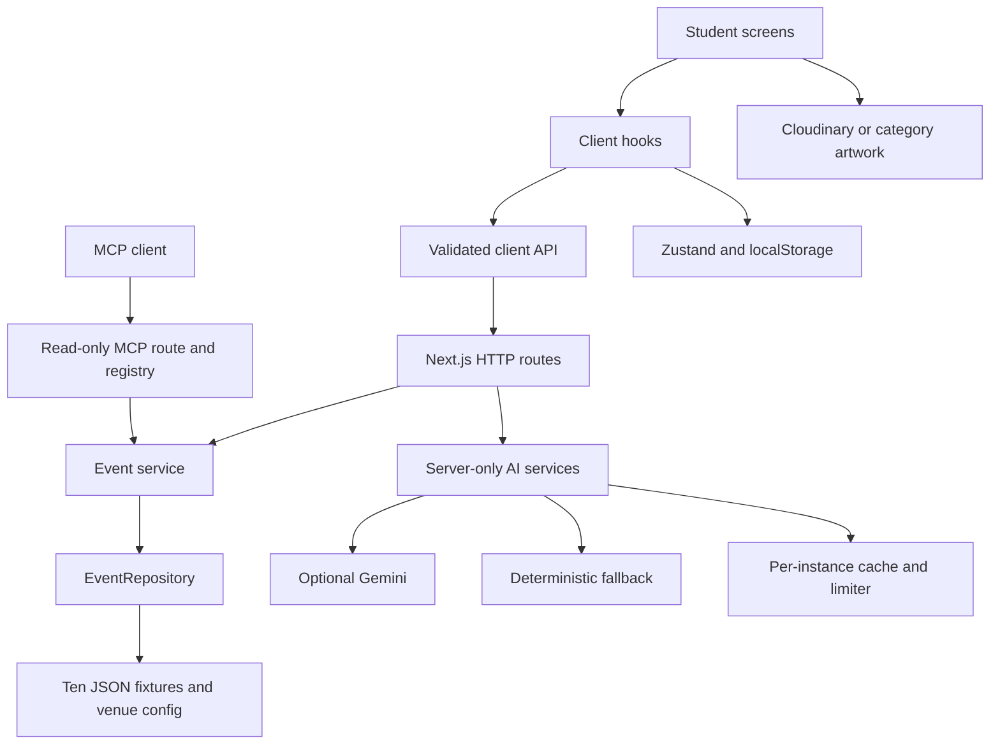
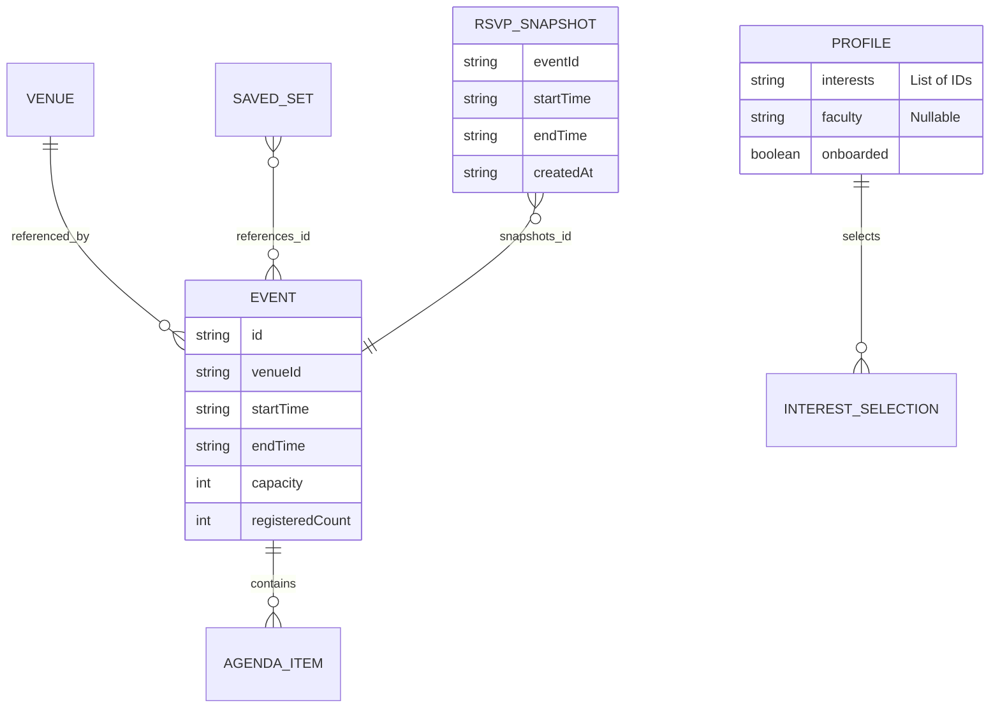

# Campus Events

Campus Events (`campus-events`, version `0.1.0`) is a responsive event discovery application for the fictional **Example University**. Students select interests, receive explainable recommendations, browse events, save them and try simulated RSVPs. The workspace directory is “Event mania project”; application branding is Campus Events.

**Current stage: functional demonstration with prototype catalogue and registration.** Ten fixtures and one university configuration power the experience. Preferences, saves and RSVP snapshots persist in the current browser. There is no database, login, official registration backend, organizer publishing system or school connector.

This README is the developer entry point. [PROJECT_INFORMATION.md](PROJECT_INFORMATION.md) covers product gaps, requirements, school integration, risks and delivery phases. Assessment date: **17 October 2026**.

## Contents

- [Current state](#current-state)
- [Purpose and features](#purpose-and-features)
- [Technology](#technology)
- [Architecture](#architecture)
- [Repository structure](#repository-structure)
- [Local setup](#local-setup)
- [Environment configuration](#environment-configuration)
- [Images and Cloudinary](#images-and-cloudinary)
- [Data and persistence](#data-and-persistence)
- [HTTP API](#http-api)
- [MCP interface](#mcp-interface)
- [Recommendations and AI](#recommendations-and-ai)
- [Identity and permissions](#identity-and-permissions)
- [Testing and quality](#testing-and-quality)
- [Deployment and operations](#deployment-and-operations)
- [Security and privacy](#security-and-privacy)
- [School integration direction](#school-integration-direction)
- [Technical debt](#technical-debt)
- [Contribution workflow](#contribution-workflow)
- [Roadmap](#roadmap)
- [License and ownership](#license-and-ownership)

## Current state

Both documents use these labels:

| Status                | Meaning                                                                                              |
| --------------------- | ---------------------------------------------------------------------------------------------------- |
| Implemented           | Present in source and supported by inspection/stated checks; not institutional production readiness. |
| Partially implemented | Some behavior exists; an important part of the complete capability is missing.                       |
| Prototype             | Demonstration behavior uses fixtures, simulation or local substitutes.                               |
| Planned               | Proposed work, not a working capability.                                                             |
| Needs verification    | External operation, configuration or evidence is unconfirmed.                                        |
| Blocked               | A specific next activity needs a missing prerequisite.                                               |

| Area                                          | Status                | Evidence                                                          | Outstanding work                                                                    |
| --------------------------------------------- | --------------------- | ----------------------------------------------------------------- | ----------------------------------------------------------------------------------- |
| Responsive student experience                 | Implemented           | `src/app`, components, viewport tests                             | School usability and broader accessibility review.                                  |
| Event catalogue                               | Prototype             | `src/data/events.stub.json`, mock repository                      | Stable, authorized records.                                                         |
| Onboarding/interests                          | Implemented           | Profile screens/store                                             | Verified identity and cross-device state.                                           |
| Matching/fallback explanations                | Implemented           | `src/matching`, AI services, tests                                | Validate usefulness with users.                                                     |
| Cloudinary delivery                           | Partially implemented | Image helpers, components, IDs and seeder                         | Verify uploaded assets and deployed delivery.                                       |
| Live Gemini                                   | Needs verification    | Server client, schemas, fallback paths                            | Confirm account/model availability, costs and real responses.                       |
| Saves and RSVP                                | Prototype             | Persisted stores and simulated transport                          | Durable accounts and transactional capacity.                                        |
| HTTP reads/read-only MCP                      | Implemented           | Routes, registry and checks                                       | Publication policy before school data.                                              |
| Tests/CI workflow                             | Implemented           | Test configs, `.github/workflows/check.yml`                       | Verify remote Actions/Vercel integration.                                           |
| Production deployment                         | Needs verification    | Build config and deployment guide                                 | Target repository/account/domain and live smoke checks.                             |
| Authentication/authorization/school isolation | Planned               | No identity or membership layer                                   | Implement before private records.                                                   |
| Durable database                              | Planned               | No database driver, ORM or migrations; fixtures/localStorage only | Choose and implement durable schema, transactions and recovery.                     |
| Backend business logic                        | Partially implemented | Event reads, filtering, scoring, AI helpers and MCP services      | Authoritative writes, identity, permission enforcement and operational persistence. |
| School connector/synchronization              | Planned               | Repository abstraction is only a read-side seam                   | Discover and build one approved interface.                                          |
| Live school pilot                             | Blocked               | No confirmed institutional/vendor agreement in repository         | Sponsor, permission, scope and test access.                                         |

Environment variables or local credentials do not prove a successful external connection. Secret file contents are not documentation evidence.

## Purpose and features

The current experience combines campus discovery, explanations and personal planning. Students are intended users; developers can inspect design examples and query public fixtures through MCP. Fragmented announcements and duplicated school work are **hypotheses**, not documented interview findings. School administrators, organizers and IT teams are proposed future stakeholders.

### Implemented

- Interest/faculty selection and editing. UI/store onboarding completion requires three interests; the shared profile schema itself permits fewer.
- Personalized feed/top match, deterministic scoring and short explanations. Feed excludes ended events and scores below 20.
- Browse search, category/venue/date filters and sorting in URL parameters. Browse includes past events.
- Event agenda, venue/map link, sharing and downloadable calendar entries.
- Responsive navigation, system dark mode, reduced motion, loading/error/empty states, dialogs/bottom sheets and toasts.
- Validated event reads, optional AI helpers and five read-only MCP tools using shared services.

### Partially implemented

Cloudinary image delivery is wired into the application, with configured asset identifiers and fallback artwork when no cloud is selected. Complete uploaded-asset delivery still needs verification. Optional Gemini services are wired and their mocked/fallback paths are tested; successful live generation is not established.

### Prototype

Saves/RSVP snapshots persist in this browser. RSVP simulates a 500 ms request with optimistic rollback, local full/past/conflict checks and cancellation. It does not reserve a server seat, coordinate users or provide official attendance. Another device cannot see those registrations.

Fixtures shift relative to the current hour; existing RSVP snapshots keep their original timestamps. This maintains demo content but creates schedule drift. Cloudinary/Gemini application paths exist; live upload completeness and AI generation remain **Needs verification**.

### Planned

School sign-in, account-backed state, organizer publishing, official registration, attendance, notifications and school synchronization are **Planned**. Grades, fees, guardian access, payments and a complete SIS are outside the first proposed MVP. No school partnership, certification or service level is claimed.

### Known limitations

The current application is a responsive website, not a native mobile application. It has one university configuration, no trusted user identity, no shared registration authority and no school data lifecycle. Browser recovery is not backup, and fixture counts are not attendance. The live-service verification limits and historical-versus-current test evidence are recorded below.

### Implementation trace

| Workflow              | Current implementation path                                                                   | Dependencies and verification                                                    |
| --------------------- | --------------------------------------------------------------------------------------------- | -------------------------------------------------------------------------------- |
| Interest onboarding   | `src/app/onboarding` → onboarding components/hooks → `src/stores` profile state               | Local storage and profile schema; interest-picker/store checks.                  |
| Browse and details    | Shell/detail pages → `src/hooks` → `src/api/eventsApi.ts` → event routes → repository/service | Validated fixtures/venues; service/card and configured E2E checks.               |
| Personalized feed     | Feed hooks → `src/matching/scoreEvent.ts` and explanation providers                           | Local preferences, event queries, deterministic rules; scoring/AI tests.         |
| RSVP and cancellation | Detail actions → RSVP hook/store → `src/api/rsvpApi.ts`                                       | Browser snapshots and simulated delay only; mutation/state/interval tests.       |
| Save and My Events    | Card/action hooks → saved/RSVP stores → My Events views                                       | Browser hydration, current event data/snapshots; store/component/journey checks. |
| Assistant reads       | `src/app/api/[transport]/route.ts` → registry → tool handlers → shared event service          | Public fixtures, per-instance limiter; tool tests and historical live MCP run.   |
| Media/metadata        | Event/venue components and image helpers → public Cloudinary IDs or fallback                  | Cloud name only for delivery; uploads and complete CDN coverage unverified.      |

### Screens

| Route                | Purpose                                                 |
| -------------------- | ------------------------------------------------------- |
| `/`                  | Personalized feed.                                      |
| `/onboarding`        | Interest/faculty selection.                             |
| `/browse`            | Search, URL filters and sorting.                        |
| `/events/[id]`       | Details; `/events/ev-004` is an example fixture.        |
| `/my-events`         | Local RSVP/saved lists and past-event disclosure.       |
| `/profile/interests` | Edit preferences.                                       |
| `/mcp`               | Registry-driven tool docs.                              |
| `/design`            | UI/state gallery; review public exposure before launch. |
| `/layout-check`      | Development utility; intentionally 404 in production.   |

### Layout

| Token |       Minimum width | Navigation  | Feed columns | Browse columns |
| ----- | ------------------: | ----------- | -----------: | -------------- |
| base  | 320 px design floor | Bottom tabs |            1 | 1              |
| xs    |              360 px | Bottom tabs |            1 | 1              |
| sm    |              480 px | Bottom tabs |            1 | 1              |
| md    |              768 px | Rail        |            2 | 2              |
| lg    |             1024 px | Rail        |            3 | 2 plus filters |
| xl    |             1280 px | Sidebar     |            3 | 2 plus filters |
| 2xl   |             1536 px | Sidebar     |            4 | 3 plus filters |

JS tokens live in `src/config/breakpoints.ts` and are re-exported through `src/lib/breakpoints.ts`; CSS has matching theme tokens. Container queries adapt Browse under zoom. Tests do not cover every device/accessibility need.

## Technology

These are **installed lockfile versions** inspected in this assessment. `package.json` uses caret ranges; `npm ci` follows `package-lock.json`.

| Technology                   | Version         | Role                                              |
| ---------------------------- | --------------- | ------------------------------------------------- |
| Next.js                      | 16.4.2          | App Router, rendering, API, build.                |
| React / React DOM            | 19.3.1          | Components.                                       |
| TypeScript                   | 6.0.3           | Strict typing.                                    |
| Tailwind CSS                 | 4.3.3           | Theme/responsive styles.                          |
| Zustand                      | 5.0.15          | Browser and transient state.                      |
| TanStack Query               | 5.104.3         | Client query/cache state.                         |
| Zod                          | 4.6.7           | Runtime validation.                               |
| Next Cloudinary / Cloudinary | 6.19.3 / 2.11.0 | Image rendering/upload script.                    |
| Google GenAI SDK             | 2.30.0          | Optional server Gemini.                           |
| mcp-handler                  | 2.3.0           | MCP transport; has separate server SDK internals. |
| MCP SDK                      | 1.32.1          | Integration client.                               |
| Vitest                       | 5.0.5           | Unit/component checks.                            |
| Playwright                   | 1.64.1          | Chromium layouts/journeys.                        |
| ESLint / Prettier            | 9.39.5 / 3.9.10 | Static checks/formatting.                         |

Other dependencies include Testing Library, axe, Sharp, Lucide, class utilities and Vercel Analytics. No database driver, ORM, identity provider or durable queue is configured. CI uses Node 22; previous local verification used Node 24. No `engines` range is enforced.

## Architecture

One modular Next.js application:



`src/server/events/index.ts` selects `MockEventRepository`. Replacing `EventRepository` is a useful read-side seam, not a complete solution for writes, identity or sync. Shared pure logic implements filters, scoring, intervals and ICS; `MatchExplainer` separates explanation providers.

Lint rules restrict client/server imports. Cache/limiter contracts are synchronous; a remote asynchronous replacement requires adapting callers too. Process-local state is not a durable job/security layer.

## Repository structure

```text
.github/workflows/check.yml    Push/PR checks and preview verification
src/
  app/
    (shell)/                  Feed, browse, my-events, interests and shell
    (detail)/events/[id]/     Event detail route group
    onboarding/              Interest onboarding
    mcp/                     Tool documentation
    design/                  Component/state gallery
    layout-check/            Development layout utility
    api/events/              Catalogue and single-event reads
    api/venues/              Venue reads
    api/categories/          Category reads
    api/ai/                  Explanation/search parsing POST routes
    api/[transport]/         MCP exposed at /api/mcp
    layout.tsx               Root layout and analytics
    providers.tsx            Client providers
    globals.css              Theme/layout styles
    opengraph-image.tsx       Social image
  api/                       Client fetchers and simulated RSVP transport
  components/                UI, layout, events, filters, feed, onboarding
  config/                    University, venues, interests, categories, constants
  data/events.stub.json      Ten relative-time fixtures
  hooks/                     Queries, hydration, actions and UI behavior
  lib/                       Filters, dates, RSVP, ICS, env/image/shared helpers
  matching/                  Scores and explanation abstraction
  schemas/                   Event, venue, profile, filters, AI, RSVP validation
  server/
    events/                  Repository/service
    ai/                      Gemini client, prompts, fallbacks
    http/                    Error wrapper and JSON responses
    cache/                   Process-local cache/limiter
    tools/                   MCP schemas, registry, handlers, summaries
  stores/                    Profile, saved, RSVP, UI, toast
  types/                     Schema-derived types
scripts/
  seed-cloudinary.ts         Generate/upload gradient placeholders
  test-mcp.ts                SDK integration client
tests/                       Unit, component, E2E
docs/
  DECISIONS.md               Decisions/historical verification
  DEPLOYMENT.md              Photo upload and GitHub/Vercel steps
output/campus-event-images-v1/ Generated covers and upload map
.env.example                 Safe environment template
next.config.ts               Next.js config
vitest.config.ts             Unit/component config
playwright.config.ts         Viewports, target, reports
README.md                    Technical onboarding/current implementation
PROJECT_INFORMATION.md       Product assessment/integration plan
```

`.next`, `node_modules`, `test-results` and `playwright-report` are generated. The `output/` pack exists locally; a clone includes it only if the owner versions/distributes it.

## Local setup

Use Node 22 as the CI baseline, npm, Git and a modern browser. No external account/database is needed for the demo. From the project root in PowerShell (same npm commands on Unix):

```powershell
npm ci
npm run dev
```

Open `http://localhost:3000/onboarding`; select three interests. If port 3000 is occupied, stop the intended server or use `npm run dev -- --port 3001` and align URL/test settings.

For integrations, copy the template without replacing existing local configuration:

```powershell
if (-not (Test-Path -LiteralPath .env.local)) {
  Copy-Item -LiteralPath .env.example -Destination .env.local
}
```

Unix:

```sh
[ -f .env.local ] || cp .env.example .env.local
```

Next.js loads `.env.local`; edit privately and restart/rebuild as needed. Standalone `tsx` scripts do **not** automatically load Next.js environment files. With Node 22, explicitly inject a file when needed:

```powershell
node --env-file=.env.local --import tsx scripts/test-mcp.ts
```

The file must exist and target an already running app. This invocation's flags are supported by the inspected Node runtime; a live external target was not exercised. The npm script otherwise uses its process environment:

```powershell
$env:MCP_URL = 'http://localhost:3000/api/mcp'
npm run test:mcp
```

Unix:

```sh
MCP_URL=http://localhost:3000/api/mcp npm run test:mcp
```

Production preview:

```sh
npm run check
npm run build
npm start
```

There are no database migrations/seeds. Clearing browser storage resets local preferences/saves/mock RSVPs, not institutional records.

## Environment configuration

Common setup problems:

| Symptom                                     | Check                                                                                                     |
| ------------------------------------------- | --------------------------------------------------------------------------------------------------------- |
| Dependencies/build fail after changing Node | Use the CI baseline and `npm ci`; inspect the actual error before changing dependency versions.           |
| E2E cannot start production server          | Run `npm run build`, install Chromium, and check port 3100 or the selected `BASE_URL`.                    |
| MCP script cannot connect                   | Start the app first; align `MCP_URL` and explicitly load/inject environment for the standalone script.    |
| New cloud name has no effect                | Restart development or rebuild/redeploy; public values are embedded at build time.                        |
| Hosted image missing                        | Verify the actual full Public ID and public delivery; a folder or display name may differ.                |
| AI always uses fallback                     | Verify server key/model availability and logs privately; fallback success does not prove live generation. |
| Saved/RSVP data missing on another device   | This is expected for browser-local prototype state; there is no account synchronization.                  |

Sources: [.env.example](.env.example), [src/lib/env.ts](src/lib/env.ts). Keep secrets out of Git, docs, screenshots and public variables.

| Variable                            | Purpose                    | Required?           | Safe example/default            | Secret?             |
| ----------------------------------- | -------------------------- | ------------------- | ------------------------------- | ------------------- |
| `NEXT_PUBLIC_CLOUDINARY_CLOUD_NAME` | Public image cloud         | For hosted images   | `your-cloud-name`               | No                  |
| `CLOUDINARY_API_KEY`                | Placeholder uploads        | Seeder only         | `<set privately>`               | Treat as credential |
| `CLOUDINARY_API_SECRET`             | Sign uploads               | Seeder only         | `<set privately>`               | Yes                 |
| `GEMINI_API_KEY`                    | Server AI                  | Optional            | `<set privately>`               | Yes                 |
| `GEMINI_MODEL_FAST`                 | Explanation model          | Optional            | `gemini-2.5-flash-lite`         | No                  |
| `GEMINI_MODEL_SMART`                | Search parser model        | Optional            | `gemini-3.8-flash`              | No                  |
| `NEXT_PUBLIC_APP_URL`               | Share/MCP canonical origin | Set for deployment  | `https://campus.example.edu`    | No                  |
| `MCP_URL`                           | Integration target         | Optional            | `http://localhost:3000/api/mcp` | No                  |
| `BASE_URL`                          | External E2E target        | External tests only | `https://preview.example.edu`   | No                  |
| `VERCEL_AUTOMATION_BYPASS_SECRET`   | Protected preview access   | When required       | `<GitHub Actions secret>`       | Yes                 |

Model IDs are configured strings, not availability guarantees; verify the smart model with the account. Missing/unavailable AI falls back. No database/session/school credential has a current application consumer.

`NEXT_PUBLIC_*` values are public/build-time; redeploy after changes. Use the intended HTTPS origin without a trailing slash, not localhost in production. Decide whether preview event links should target the preview or production.

## Images and Cloudinary

Events/venues store **Public IDs**, not full URLs. With no cloud name, category artwork appears. A configured cloud with missing assets needs correction; the no-cloud fallback does not prove every remote failure recovers.

Follow [docs/DEPLOYMENT.md](docs/DEPLOYMENT.md). [The generated pack](output/campus-event-images-v1/README.md) has ten AI-generated photographic-style covers of fictional adult campus events, not documentary photographs. It does not include six venue photos.

| Image                              | Exact full Public ID           |
| ---------------------------------- | ------------------------------ |
| Campus Hackathon Kickoff           | `tech-01`                      |
| Intro to Machine Learning Workshop | `tech-02`                      |
| Inter-Faculty Football Final       | `sports-01`                    |
| Open Mic Night                     | `music-01`                     |
| Career Fair                        | `careers-01`                   |
| CV Clinic with Alumni              | `careers-02`                   |
| Chess and Debate Mixer             | `clubs-01`                     |
| Photography Walk                   | `arts-01`                      |
| Jazz Evening                       | `music-02`                     |
| Campus 5K Fun Run                  | `sports-02`                    |
| Main Auditorium                    | `venues/main-auditorium`       |
| Engineering Lab Block              | `venues/engineering-lab-block` |
| Sports Complex                     | `venues/sports-complex`        |
| Student Union Hall                 | `venues/student-union-hall`    |
| Library Atrium                     | `venues/library-atrium`        |
| Amphitheatre                       | `venues/amphitheatre`          |

Verify full Public ID in asset details, excluding extension/cloud/version/URL. A folder/display name alone may not establish that ID. Manual public delivery needs only the public cloud name in this app, not upload credentials in Vercel.

**`npm run seed:images` creates 16 gradient placeholders with `overwrite: true`. It does not upload the photographic pack and replaces matching photos.** Use only intentionally with privately injected credentials. Review provenance, truthful labeling and image permissions. All ten root-level event assets returned HTTP 200 with image/png during the image-path update. Venue assets and rendered production delivery still need verification.

## Data and persistence

### Actual model

There is **no database**. `MockEventRepository` validates ten fixtures, adds a default 300 ms read delay and converts offsets using the current hour. University/venue/category metadata is configured. IDs are logical references, not database foreign keys.

| Object        | Fields/constraints                                                                                                         | Storage                                                                                            |
| ------------- | -------------------------------------------------------------------------------------------------------------------------- | -------------------------------------------------------------------------------------------------- |
| Event         | ID, title, description, category, tags, venue ID, organizer, nullable faculty, capacity/count, cover ID, start/end, agenda | JSON transformed at read time; capacity positive, count no greater than capacity, end after start. |
| Venue         | ID, name, photo ID, map URL, description                                                                                   | Six configured records.                                                                            |
| Profile       | Up to ten supported interests, nullable faculty, onboarded                                                                 | Browser, not verified identity/enrolment.                                                          |
| Saved set     | Event IDs                                                                                                                  | Browser.                                                                                           |
| RSVP snapshot | Event ID/title, start/end, created timestamp                                                                               | Browser dictionary; no account/school/transaction.                                                 |
| Filters       | Query, categories/venues, date/range, sort                                                                                 | URL/client.                                                                                        |
| Score         | 0–100, matched interests, category match, reasons                                                                          | Computed relevance.                                                                                |

Categories: `tech`, `sports`, `music`, `careers`, `clubs`, `arts`. Zod schemas live in `src/schemas`; types are inferred. This ER-style diagram describes **logical fixture/browser references, not relational tables**:



Keys: `campus-events:profile:v1`, `campus-events:saved:v1`, `campus-events:rsvp:v1`. Stores validate/recover versioned JSON and hydrate explicitly. These migrations are browser recovery, not database migrations/backups. UI/toast state is transient.

Dates are ISO strings. Presets use local server/browser boundaries and Monday weeks; custom range upper bound is exclusive. Institution timezone policy is missing. RSVP uses half-open intervals; touching endpoints do not conflict. ICS uses escaped text, UTC, CRLF and 75-octet line folding.

### Proposed durable model

**Planned only:** School, User, SchoolMembership, authoritative Event/Venue, RSVP, SchoolConnection, ExternalReference, SyncRun and AuditEntry. See [canonical model](PROJECT_INFORMATION.md#canonical-data-and-identifiers). No SQL schema/migration exists. Local preferences cannot automatically become verified membership.

## HTTP API

Current routes are public and unauthenticated, exposing fixtures/configuration. Do not add private records without access control and revised caching.

| Method/path                 | Input                                        | Success                      | Side effects                                                                  |
| --------------------------- | -------------------------------------------- | ---------------------------- | ----------------------------------------------------------------------------- |
| `GET /api/events`           | URL filters below                            | `CampusEvent[]` JSON         | Read/reanchor fixtures.                                                       |
| `GET /api/events/{id}`      | Exact ID                                     | `CampusEvent` JSON           | Read only.                                                                    |
| `GET /api/venues`           | None                                         | Venue array                  | Read only.                                                                    |
| `GET /api/categories`       | None                                         | Category metadata array      | Read only.                                                                    |
| `POST /api/ai/parse-search` | `{ "query": "music this week" }`             | Filter object                | Optional external AI/limiter state.                                           |
| `POST /api/ai/explanations` | Profile and at most 12 event/score summaries | Explanation map and `source` | Optional AI/cache/limiter state.                                              |
| `GET/POST/DELETE /api/mcp`  | MCP messages                                 | Protocol response            | Read-only tools; stateless adapter may reject unsupported session operations. |

No server RSVP, save, sign-in, import, grade, fee or event-edit endpoints exist. `src/api/rsvpApi.ts` is simulation, not a network write.

### Filters and request examples

`query` matches title/tags case-insensitively, maximum 200 characters. Repeat `category`/`venue` for multiple values. `date` accepts `any`, `today`, `week`, `month`, `custom`; `from`/`to` are ISO timestamps. Sort is `soonest`, `best-match`, `popular`; popular uses fixture counts. HTTP service has no implicit browser profile, so best-match is not automatically personalized; Browse ranks with its local profile.

```powershell
Invoke-RestMethod 'http://localhost:3000/api/events?category=music&sort=soonest'
Invoke-RestMethod 'http://localhost:3000/api/events/ev-004'
Invoke-RestMethod -Method Post -Uri 'http://localhost:3000/api/ai/parse-search' -ContentType 'application/json' -Body '{"query":"music this week"}'
```

Unix:

```sh
curl 'http://localhost:3000/api/events?category=music&sort=soonest'
curl -X POST http://localhost:3000/api/ai/parse-search \
  -H 'Content-Type: application/json' -d '{"query":"music this week"}'
```

Illustrative parser response; values depend on input/provider:

```json
{
  "query": "",
  "categories": ["music"],
  "venueIds": [],
  "datePreset": "week",
  "sort": "soonest"
}
```

Explanation input, with illustrative score values:

```json
{
  "interests": ["music", "tech", "arts"],
  "faculty": null,
  "events": [
    {
      "id": "ev-004",
      "title": "Open Mic Night",
      "category": "music",
      "tags": ["music"],
      "score": {
        "score": 70,
        "matchedInterests": ["music"],
        "categoryMatched": true,
        "reasons": ["Matches your music interest."]
      }
    }
  ]
}
```

Illustrative fallback response:

```json
{
  "explanations": { "ev-004": "Matches your music interest." },
  "source": "fallback"
}
```

### Errors and cache behavior

`handleRoute` returns `{ "error": { "code": "...", "message": "..." } }`. Invalid JSON/schema input returns 400; unknown event reads return 404; unexpected errors log internally and return generic 500. Error classes also define upstream/rate-limit statuses, but their presence does not mean every route emits them.

AI failure/quota exhaustion normally returns **200 with deterministic fallback**, not 429. MCP quota rejection returns 429; individual tool errors set protocol `isError`. Catalogue reads use `public, s-maxage=60, stale-while-revalidate=300`; other wrapped JSON defaults to `no-store`. MCP has separate transport semantics. Never reuse public caching for private responses.

There is no HTTP pagination contract. Client “load more” with ten fixtures is not a scalable backend pagination implementation.

## MCP interface

`/api/mcp` is the student-facing Streamable HTTP endpoint; `/mcp` documents `src/server/tools/toolRegistry.ts`.

| Tool               | Input                                                         | Result                                    |
| ------------------ | ------------------------------------------------------------- | ----------------------------------------- |
| `search_events`    | Optional query/category/venue/from/to; limit 1–20, default 10 | Matching summaries.                       |
| `get_event`        | Required exact `id`                                           | Event detail; unknown ID is a tool error. |
| `recommend_events` | Up to ten interests, optional nullable faculty, limit 1–20    | Ranked summaries with scores.             |
| `list_venues`      | Empty object                                                  | Six venues.                               |
| `list_categories`  | Empty object                                                  | Six categories.                           |

Annotations declare read-only, non-destructive, idempotent operations. Results serialize JSON into text content; failures set `isError: true`. Summaries include URLs from `NEXT_PUBLIC_APP_URL`. Tools cannot access browser saves/RSVPs. The 20 requests/minute/IP limiter is shared with AI helpers within an instance, not a deployment-wide allowance.

For clients needing a stdio bridge:

```json
{
  "mcpServers": {
    "campus-events": {
      "command": "npx",
      "args": ["-y", "mcp-remote", "https://YOUR-DOMAIN/api/mcp"]
    }
  }
}
```

`mcp-remote` is an external client bridge, not an installed project dependency; review/pin it according to client policy. Run `scripts/test-mcp.ts` against a running app. Future write tools require authenticated services, permission checks and changed annotations.

### Separate developer Vercel MCP

Vercel's developer MCP at `https://mcp.vercel.com` uses account authorization to inspect deployments/logs. It is separate from the application endpoint and student identity. Previous setup guidance is retained; no account connection is claimed. See [official setup](https://vercel.com/docs/agent-resources/vercel-mcp) and [tools](https://vercel.com/docs/agent-resources/vercel-mcp/tools).

```sh
codex mcp add vercel --url https://mcp.vercel.com
codex mcp login vercel
codex mcp list
```

Equivalent separate client configuration:

```toml
[mcp_servers.vercel]
url = "https://mcp.vercel.com"
```

These belong to the separate Codex CLI, not npm scripts. Complete OAuth for the intended team/account. No connection settings were changed during documentation.

## Recommendations and AI

Scoring awards up to 45 category points, up to 35 tag points at 15 per unique match, up to 10 timing points over the next seven days, and 10 for matching non-null faculty. Ended events score zero; scores round/cap at 100 and ties order by start time. Relevance is not attendance probability or access permission.

Gemini runs server-side with structured prompts, JSON-schema output, response validation and a four-second timeout. Missing keys, unavailable models, invalid/partial replies and timeouts fall back. Explanations are limited to sixteen words; unknown IDs are discarded and missing IDs filled locally. A response-level `source` may cover mixed AI/fallback entries; it is not per-item provenance.

Explanation cache: 24-hour TTL, 2,000 entries, one instance. Keys use profile characteristics and event ID, not event revision; real edits need invalidation/versioning. The limiter holds at most 10,000 IP keys. Scaling/restarts duplicate or reset these controls. Forwarded IP trust depends on the hosting proxy.

Some suspicious query patterns bypass Gemini and common email/phone patterns are redacted. This does not remove every personal detail or prevent every prompt attack. Do not pass private student/academic/health records through this current feature.

## Identity and permissions

Authentication establishes identity; authorization determines permitted actions. **Neither is implemented.** Avatar, local profile and faculty selection do not prove identity/enrolment or enforce eligibility. Vercel preview protection is not student access control.

Proposed roles: student, organizer, school administrator, integration operator, platform operator. Students manage only their own records; organizers publish within granted scope; school administrators operate within their school. Integration operators should not require unrestricted student access. Private permissions must be server-enforced with cross-school denial. Guardian/academic roles are outside the initial event MVP pending research.

## Testing and quality

| Command               | Purpose                                          | Prerequisite                              |
| --------------------- | ------------------------------------------------ | ----------------------------------------- |
| `npm run lint`        | ESLint, import boundaries, zero warnings         | Dependencies.                             |
| `npm run typecheck`   | Strict TS, unchecked index/exact optional checks | Dependencies.                             |
| `npm test`            | Vitest unit/components                           | AI mocked; no paid calls.                 |
| `npm run check`       | Lint, typecheck, tests                           | Same.                                     |
| `npm run build`       | Production build                                 | Select build-time config.                 |
| `npm start`           | Production server                                | Build first.                              |
| `npm run test:e2e`    | Layouts/journeys/axe                             | Build; `npx playwright install chromium`. |
| `npm run test:mcp`    | Five tools, invalid input, unknown IDs           | Running app and target env.               |
| `npm run seed:images` | Placeholder upload                               | Credentials; overwrites matching IDs.     |

Unit checks cover schemas, services/filtering, scoring, local recovery, hydration, environment, RSVP/ICS, AI fallbacks and tools. Components cover cards, interests, RSVP states/mutations, toast and bottom sheet. No measured coverage percentage is supplied.

Playwright projects: 320×640, 360×800, 390×844, 768×1024, 1024×768, 1280×800 and 1536×864. Cases check public routes, critical/serious axe findings, touch targets, grids, zoom and selected journeys. Some journey/dialog cases intentionally run only at 390×844; dark-mode cases use selected widths. Automated axe is not a full accessibility certification.

Without `BASE_URL`, E2E starts a production server on port 3100; build first. With it, tests target the external origin. Reports/traces/screenshots go to `playwright-report/` and `test-results/`. Reassess safety before future tests can write authoritative data.

### Evidence and limits

**Fresh assessment check, 17 October 2026:** `npm run check` passed lint, strict TypeScript and **69 tests in 15 files**.

[docs/DECISIONS.md](docs/DECISIONS.md) records an earlier implementation run: successful build, 61 passed/23 intentional E2E skips, all five local live MCP tools checked, and zero production advisories at that audit time. It also records development lint-chain advisories. These are historical results, not continuous guarantees. Build/E2E/live MCP/audit were not rerun for this documentation change.

Cloudinary/Gemini/Vercel live operation remains unverified. No institutional connector contract, cross-school, transactional concurrency, load or restore tests exist for the planned architecture.

## Deployment and operations

The current app can be deployed as a fixture demo; this does not approve handling school records. Follow [docs/DEPLOYMENT.md](docs/DEPLOYMENT.md).

1. Run `npm ci`, `npm run check`, `npm run build`; inspect diff and secret exclusions.
2. Push to the intended GitHub repository/branch; inspect the remote before replacing it.
3. Import into the intended Vercel team/account using Next.js preset, repository root, `npm ci` and `npm run build`. Select production branch deliberately.
4. Set cloud name if needed, canonical HTTPS origin and optionally verified Gemini credentials/model. Public image delivery needs no upload credentials in Vercel.
5. Deploy/redeploy after public-variable changes. Smoke-test onboarding, Browse, all images, local Save/RSVP, My Events, sharing, calendar and MCP URLs.
6. Review `/design` exposure and verify production `/layout-check` is 404.

GitHub Actions checks/builds pushes/PRs on Node 22. Successful non-Production deployment status events trigger MCP/browser preview checks and report upload. This needs Vercel Git integration/events and possibly a protection bypass secret. Workflow presence is not proof of remote operation.

Vercel Analytics is in root layout; activation/reporting, access and privacy policy need verification. Current aids are logger/platform logs and test artifacts. No dedicated health endpoint, uptime monitor, incident rota, durable audit, backup/restore system or sync console exists.

For demo failures, inspect build/runtime logs, variable names, public IDs and canonical origin; deploy a known-good revision when appropriate. Future database migrations need separate recovery plans: deployment rollback does not reverse data changes. An old note's localhost server is not current availability evidence.

## Security and privacy

Existing foundations include Zod validation, server-only credentials, source boundaries, generic unexpected errors and bounded process-local controls. They are not a completed institutional security review.

Before private records: implement identity/membership, object-level permissions and tenant tests; transactions/audit; managed connector secrets/revocation; body limits/shared quotas; retention/deletion/export policy; backups and incident response. Public caches must never serve private responses. Browser storage is script-accessible and cannot be the sole trusted record.

Confirm rotation of credentials previously shared outside their intended secret store; completion is not evidenced. Obtain institutional data/image permission, define controller/processor responsibilities and assess hosting/CDN/AI transfers. Redact logs.

Jurisdiction and learner ages are unconfirmed. If Kenyan schools are selected, qualified review should consider applicable law/regulations and ODPC education/children guidance. No compliance/certification is claimed. See [the sourced privacy plan](PROJECT_INFORMATION.md#security-privacy-and-governance).

## School integration direction

Extend discovery with identity, authoritative events/RSVP and **one approved read-only school connection**. Do not attempt a complete SIS replacement first. Allowed connector entities—events, minimal membership verification or another subset—depend on actual interface/permission. Do not import a student directory by default.

Options include supported APIs, signed webhooks, approved files, exceptionally authorized read-only database views and manual fallback. None is implemented. Confirm vendor/version, licensing, schemas, auth, sandbox and data rights first. Keep mapping outside components; add storage/workers where justified. See [integration specification](PROJECT_INFORMATION.md#school-integration-specification).

## Technical debt

Priorities follow [shared definitions](PROJECT_INFORMATION.md#priorities). P0 is a blocker for its relevant release, not proof the fixture demo cannot run.

| Priority                | Gap/evidence                                   | Impact                         | Resolution/acceptance                                                             |
| ----------------------- | ---------------------------------------------- | ------------------------------ | --------------------------------------------------------------------------------- |
| P0 before private data  | No identity/tenant checks                      | Unauthorized access            | Server permissions; negative object/cross-school tests.                           |
| P0 before official RSVP | Local simulation, no transaction               | Capacity races/unowned records | Unique account/event registrations; atomic capacity/cancel and concurrency tests. |
| P1                      | Shifting fixtures/retained snapshots           | Schedule drift                 | Stable timestamps/revisions and institution timezone.                             |
| P1                      | No confirmed school interface/rights           | Feasibility unknown            | Approved discovery and synthetic/sandbox contract fixtures.                       |
| P1                      | CDN/model/deployment unverified                | Media/fallback/link failures   | Recorded live smoke checks without secrets.                                       |
| P1                      | No recovery plan                               | Operational failure risk       | Demo runbook; restore/sync recovery before pilot.                                 |
| P2                      | In-memory synchronous cache/limiter            | Multi-instance inconsistency   | Shared service, async adaptation and quota tests.                                 |
| P2                      | Cache omits event revision                     | Stale explanations             | Revisioned keys/invalidation regression test.                                     |
| P2                      | Incomplete AI payload bounds                   | Cost/abuse                     | Body/field limits, quota/failure tests.                                           |
| P2                      | Local date boundaries                          | Timezone mismatch              | Institution timezone/boundary tests.                                              |
| P2                      | No pagination contract                         | Scaling risk                   | Stable order/cursor when measured need warrants.                                  |
| P2                      | No institutional/manual accessibility research | Adoption/access unknown        | Moderated tasks and assistive-technology review.                                  |
| P3                      | Extra vendors/academic modules                 | Scope/maintenance cost         | Defer pending pilot and funded ownership.                                         |

## Contribution workflow

Push/PR/preview checks exist; branch protection, CODEOWNERS and release ownership are not evidenced. Proposed review discipline:

1. Agree a scoped issue and acceptance criteria; use synthetic data.
2. Create a feature branch; preserve boundaries/shared schemas.
3. Add meaningful behavioral checks and update affected documentation.
4. Run `npm run check`; build/relevant E2E/MCP when affected. Format docs with `npx prettier --write README.md PROJECT_INFORMATION.md`.
5. Inspect diff/secrets; open a PR explaining problem, outcome, evidence and limits.
6. Review preview and obtain agreed institutional release approval. Include migrations/recovery/connector compatibility when implemented.

Use `npm ci`; exclude local environments, dependencies, reports and builds. Decide media distribution and preserve provenance/mapping.

## Roadmap

| Phase                   | Outcome                          | Exit evidence                                                      |
| ----------------------- | -------------------------------- | ------------------------------------------------------------------ |
| 0: Assessment           | Agreed current state/scope       | Reviewed documentation/decisions.                                  |
| 1: Stabilization        | Reproducible honest demo         | Fresh checks, images/domain verified, rotation confirmed, runbook. |
| 2: Discovery            | One feasible school path         | Sponsor, vendor/version, rights, samples, approved scope.          |
| 3: Foundations          | Trusted records/access           | Identity, durable events/RSVP, isolation/recovery tests.           |
| 4: Connector pilot      | One school/read-only connector   | Dry-run, mapping/idempotency/recovery evidence and acceptance.     |
| 5: Production readiness | Controlled institutional release | Security/privacy/accessibility/support/restore sign-off.           |
| 6: Expansion            | Evidence-based scope             | Accepted pilot outcomes, funding, compatibility plan.              |

No percentage/calendar commitment is inferred. Recommended milestone: an **authoritative authenticated event-and-RSVP foundation**, informed by one school's approved discovery. See [phase details](PROJECT_INFORMATION.md#phased-delivery-plan).

## License and ownership

No root license file was found. `private: true` prevents accidental npm publishing; it is not a redistribution license. The owner must decide licensing, contributor ownership and institutional/vendor agreements. Dependencies retain their licenses. Generated-image provenance does not settle school branding, publicity, likeness or third-party permissions.
